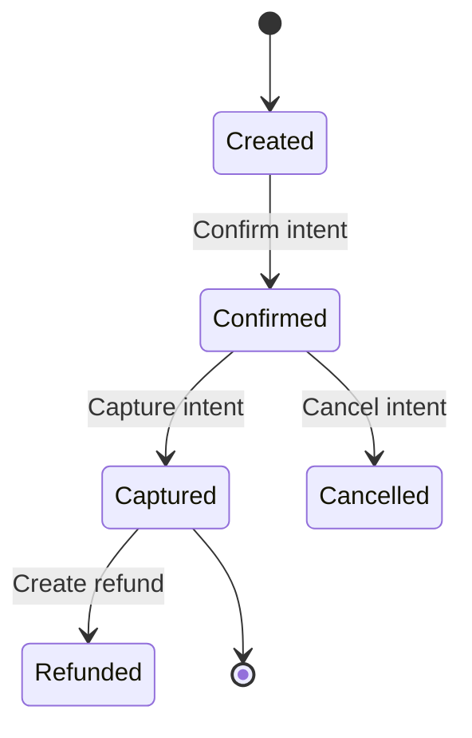

{/*
  COPY-PASTE CHUNKS
  Reusable Mintlify blocks for the MyGigsters docs. Not in the navigation.
  Copy a block into any page. All facts come from the current docs;
  anything marked TODO needs your input.
*/}

{/* ───────────── 1. HERO (landing page, custom layout) ─────────────
   Use in index.mdx with `mode: "custom"` in the frontmatter for a
   full-width landing page with no sidebar. */}

<div className="px-6 py-16 lg:py-24 max-w-3xl mx-auto text-center">
  <p className="text-sm font-semibold tracking-wide uppercase text-[#6253E5]">MyGigsters Payments API</p>
  <h1 className="mt-3 text-4xl lg:text-5xl font-semibold tracking-tight text-gray-900 dark:text-zinc-50">
    Payments for marketplaces
  </h1>
  <p className="mt-5 text-lg text-gray-600 dark:text-zinc-400">
    Collect payments from your customers and pay out your workers through one API, built for marketplaces.
  </p>
  <div className="mt-8 flex justify-center gap-3">
    <a href="/get-started/quickstart" className="px-5 py-2.5 rounded-full bg-[#6253E5] text-white font-medium">Start building</a>
    <a href="/api-reference/introduction" className="px-5 py-2.5 rounded-full border border-gray-300 dark:border-zinc-700 font-medium text-gray-900 dark:text-zinc-50">API reference</a>
  </div>
</div>

{/* ───────────── 2. QUICKSTART STEPS ───────────── */}

<Steps>
  <Step title="Generate an API key">
    In the MyGigsters dashboard, go to **Settings → API Keys** and generate a key. You receive a key identifier (`uuid`) and a secret. The secret is shown once, so store it securely.
  </Step>
  <Step title="Make your first request">
    Send your key pair with HTTP Basic authentication and include the `X-API-Version` header.

    <CodeGroup>
    ```bash cURL
    curl https://qa-payments.mygigsters.com.au/api/v1/customer \
      -u "YOUR_UUID:YOUR_SECRET" \
      -H "X-API-Version: 1.2" \
      -H "Content-Type: application/json" \
      -d '{ ... }'
    ```

    ```javascript Node.js
    const res = await fetch("https://qa-payments.mygigsters.com.au/api/v1/customer", {
      method: "POST",
      headers: {
        Authorization: "Basic " + Buffer.from(`${UUID}:${SECRET}`).toString("base64"),
        "X-API-Version": "1.2",
        "Content-Type": "application/json",
      },
      body: JSON.stringify({ /* ... */ }),
    });
    ```

    ```python Python
    import requests

    res = requests.post(
        "https://qa-payments.mygigsters.com.au/api/v1/customer",
        auth=(UUID, SECRET),
        headers={"X-API-Version": "1.2"},
        json={},  # ...
    )
    ```
    </CodeGroup>
  </Step>
  <Step title="Pick a guide">
    Charge a customer, pay a worker, or send a payment link.
  </Step>
</Steps>

{/* ───────────── 3. ENVIRONMENTS TABLE ───────────── */}

| Environment | Base URL | Use for |
| --- | --- | --- |
| Demo (QA) | `https://qa-payments.mygigsters.com.au/api/v1` | Development and testing. No real money moves. |
| Production | `https://prod-payments.mygigsters.com.au/api/v1` | Live payments and payouts. |

<Warning>
  API keys are environment-specific. A key generated in the demo dashboard does not work in production.
</Warning>

{/* ───────────── 4. CALLOUTS ───────────── */}

<Warning>
  Never put API credentials in client-side code, mobile apps, or public repositories. Make all API calls from your server.
</Warning>

<Note>
  Every request must include `X-API-Version: 1.2`. Requests without a supported version are rejected.
</Note>

<Tip>
  Send an `Idempotency-Key` header on `POST` and `PUT` requests so a retry never creates a second payment or payout.
</Tip>

<Info>
  Version 1.1 reaches end of life on 31 December 2026. See the upgrade guide to move to 1.2.
</Info>

{/* ───────────── 5. GUIDE PAGE SKELETON ─────────────
   Frontmatter goes at the very top of the page file. */}

{/*
---
title: "Charge a customer"
description: "Save a card and take a payment with payment intents."
---
*/}

## Before you begin

- An API key for the demo environment
- TODO: other prerequisites

## How it works

TODO: one paragraph, then a diagram if the flow has more than three steps.

<Steps>
  <Step title="Create a customer">TODO</Step>
  <Step title="Save a card">TODO</Step>
  <Step title="Create and confirm a payment intent">TODO</Step>
  <Step title="Handle the result">TODO: webhook event names</Step>
</Steps>

## Test your integration

TODO: test cards and expected outcomes.

## Next steps

<Columns cols={2}>
  <Card title="Issue refunds" icon="rotate-left" href="/guides/refunds" />
  <Card title="Receive webhooks" icon="bell" href="/security/webhooks" />
</Columns>

{/* ───────────── 6. PAYMENT INTENT LIFECYCLE DIAGRAM ─────────────
   TODO: confirm state names against the Payment Intent Lifecycle page. */}



{/* ───────────── 7. CHANGELOG ENTRY (changelog.mdx) ───────────── */}

<Update label="January 2026" description="Version 1.2" tags={["Current"]}>
  ## Added
  - snake_case field names across all requests and responses (breaking; requires the 1.2 header)
  - Idempotency key support on `POST` and `PUT`
  - Card SDK and Beneficiary SDK
  - Document verification, Partner Account, Wallet balances, and Credit Notes
  - Restricted API keys

  ## Changed
  - One error format for all 4xx and 5xx responses
  - HMAC-SHA256 signatures on webhooks
</Update>

<Update label="June 2025" description="Version 1.1" tags={["Maintenance"]}>
  First release: payments, customers, worker payouts, invoicing, API keys, and webhooks. End of life 31 December 2026.
</Update>

{/* ───────────── 8. EMBEDDED FINANCE SECTION (optional, for index.mdx) ─────────────
   Mirrors Stripe Connect's "Embedded financial products". Only add if you
   want to cross-sell from the docs. TODO: confirm wording and links. */}

## Embedded financial products

<Columns cols={2}>
  <Card title="EarlyPay" icon="bolt" href="mailto:hello@mygigsters.com.au">
    Let workers get paid for completed work before the invoice is settled.
  </Card>
  <Card title="Gigsters Super" icon="piggy-bank" href="mailto:hello@mygigsters.com.au">
    Meet superannuation obligations for the workers on your marketplace.
  </Card>
</Columns>

{/* ───────────── 9. REGULATORY FOOTER ─────────────
   TODO: replace with the disclosure your compliance team approves. */}

<Note>
  TODO: licensing and authorised-representative disclosure.
</Note>
