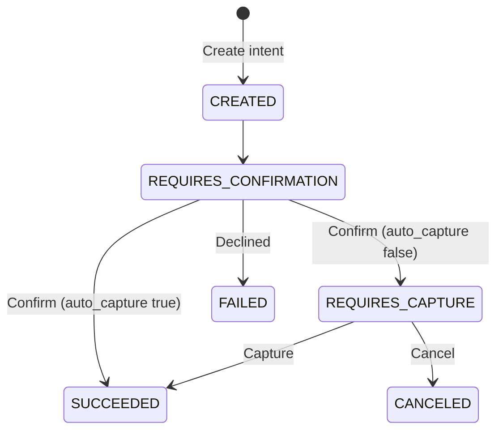

A payment intent moves through a fixed set of states. Knowing them tells you when funds are held, when they're taken, and what to do next.

| State | What it means | What to do next |
|---|---|---|
| `CREATED` | The intent exists with an amount, job, and currency. No money is held yet. | Confirm the intent. |
| `REQUIRES_CONFIRMATION` | Waiting for payment details, the customer's default card, to be provided by a confirm request. | [Confirm intent](/api-reference/payment-intents/confirm-intent). |
| `REQUIRES_CAPTURE` | The customer's bank has authorised the funds and placed a hold. | [Capture intent](/api-reference/payment-intents/capture-intent) within 7 days, or [cancel](/api-reference/payment-intents/cancel-intent). |
| `SUCCEEDED` | The funds have been captured and processed. Payouts can now be scheduled using these funds. | Nothing. Refund later if needed. |
| `CANCELED` | The intent was cancelled before capture, releasing the hold on the customer's card. | Nothing. |
| `FAILED` | The transaction failed because of insufficient funds, card expiry, or another bank decline. | Ask the customer for another card and create a new intent. |

<Warning>
  A hold lasts 7 days. Capture within that window or the authorisation lapses.
</Warning>

Check an intent's current state at any time with [Retrieve intent](/api-reference/payment-intents/retrieve-intent).
