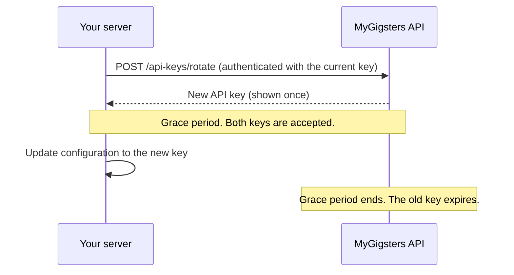

This page covers how data is encrypted, how to manage your API keys, what we log, where your data is stored, and how often we test our defences.

## Encryption

| Where | How it's protected |
|---|---|
| In transit | Every API call is encrypted with TLS (HTTPS). Unencrypted HTTP calls are rejected. |
| At rest | All stored data is encrypted with AES-256, the current standard on the cloud platforms we run on. |

## Server-to-server calls

Never embed secret API credentials in a mobile app or web front end. Make every authenticated request from your own backend servers.

## Card data

Raw card details never touch your servers. Your customers enter them in hosted fields and SDK frames served by MyGigsters, and you receive a card token to use for payments. See the [Card SDK](/sdks/card-sdk).

## API key management

### Rotate keys every month

We recommend rotating your API keys every month. You can automate it: the [Rotate API key endpoint](/security/api-keys-and-rotation#rotate-an-api-key) replaces a key in code, with no downtime, so rotation can run on a schedule instead of relying on someone to do it by hand in a dashboard.

<Steps>
  <Step title="Call the rotate endpoint">
    Authenticate with your current key and call [`POST /api/v1/api-keys/rotate`](/security/api-keys-and-rotation#rotate-an-api-key). You receive a new key.
  </Step>
  <Step title="Switch over during the grace period">
    Both keys are accepted until the grace period ends, so you can deploy the new key without interrupting service.
  </Step>
  <Step title="The old key expires">
    When the grace period ends, the old key stops working automatically.
  </Step>
</Steps>

<Card title="Rotate API key endpoint" icon="rotate" href="/security/api-keys-and-rotation#rotate-an-api-key" horizontal>
  How automated rotation works, with request fields, code examples, rules, and errors.
</Card>

You can also revoke a key immediately if you think it has been exposed. See [Revoke an API key](/security/api-keys-and-rotation#revoke-an-api-key).

### Limit what each key can do

Give each application or integration its own restricted key. A restricted key has a permission for each module, such as Payments, Payouts, Workers, or Invoices, so it can only reach the resources that integration needs. If a restricted key leaks, the damage is limited to those modules. See [Restricted keys](/security/restricted-keys).

### Good practice

- Store keys in a secrets manager, never in source code.
- Use a separate key for each environment and each integration.
- Rotate monthly, and straight away when someone with access leaves your team.
- Revoke keys you no longer use.

## Audit logging

| What's logged | Details |
|---|---|
| Payout attempts | Every attempt, successful or not, with the IP address and user name that made it. |
| API key events | Every key created, rotated, revoked, and expired. |

Logs are kept for seven years.

## Data residency

We aim to store your data in your own country.

| Your country | Where your data is stored |
|---|---|
| Australia | Sydney and Melbourne |
| India | Mumbai |
| Singapore | Singapore |
| South Africa | Cape Town |

## Penetration testing

Our systems are penetration tested every three months.

## More ways to build securely

<Columns cols={2}>
  <Card title="Receive webhooks" icon="webhook" href="/security/webhooks">
    Verify that events come from MyGigsters.
  </Card>
  <Card title="Idempotency" icon="repeat" href="/security/idempotency">
    Retry requests safely without paying twice.
  </Card>
</Columns>
