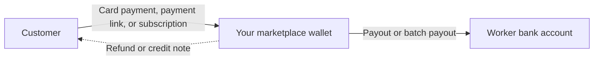

A marketplace has three parties: the **customer** who pays for work, the **worker** who does it, and **your marketplace** in the middle. The Payments API gives you an object for each party and an API for each movement of money between them.

## Who's involved

| Party | Who they are | API object |
| --- | --- | --- |
| Your marketplace | The marketplace or SaaS business that integrates the API | API key |
| Customer | The person or business paying for work | Customer, Card |
| Worker | The gig worker or freelancer being paid | Worker, Beneficiary |
| Partner | A vertical SaaS provider or fintech company that offers MyGigsters to its own customers | Partner Account |
| Connected account | A business a partner onboards under its partner account | Partner Account |

## How money moves

<Steps>
  <Step title="Collect">
    Create a customer, save their card, and charge them with a payment intent. You can also send a payment link or an invoice instead of building a checkout.
  </Step>
  <Step title="Hold">
    Collected funds settle into your wallet. Check available, pending, and reserved balances before you pay out.
  </Step>
  <Step title="Pay out">
    Register each worker with their bank details, then pay them individually or in a batch. Track every payout to completion.
  </Step>
  <Step title="Stay in sync">
    Subscribe to webhooks so your system hears about payments, refunds, and payouts as they happen.
  </Step>
</Steps>

## Choose your integration

<Tabs>
  <Tab title="Marketplace">
    You charge customers and pay workers. This is the full flow.

    **You'll use:** Customers, Cards, Payment Intents, Workers, Payouts, Webhooks.

    <Card title="Start with charging a customer" icon="credit-card" href="/guides/charge-a-customer" horizontal />
  </Tab>
  <Tab title="Payouts only">
    You already collect money elsewhere and only need to pay workers.

    **You'll use:** Workers, Payouts, Wallet, Webhooks.

    <Card title="Start with onboarding a worker" icon="user-plus" href="/guides/onboard-and-pay-a-worker" horizontal />
  </Tab>
  <Tab title="Partner">
    You are a vertical SaaS provider or fintech company. You onboard other businesses as connected accounts and move money on their behalf.

    **You'll use:** Partner Account, Connected Accounts, Batch Payouts, Partner Webhooks.

    <Card title="Start with the partner overview" icon="sitemap" href="/platform/overview" horizontal />
  </Tab>
</Tabs>

## What you build and what we handle

| You build | MyGigsters handles |
| --- | --- |
| Your product, pricing, and worker experience | Card capture and tokenisation through hosted fields |
| When to charge and when to pay out | Moving funds and tracking payout status |
| Your own records of jobs and earnings | Invoices, receipts, and credit notes |
| Reacting to webhook events | Bank-account validation and document checks |

## Next steps

<Columns cols={2}>
  <Card title="Quickstart" icon="rocket" href="/get-started/quickstart">
    Make your first API request.
  </Card>
  <Card title="Core objects" icon="cubes" href="/concepts/core-objects">
    See how the API objects relate.
  </Card>
</Columns>
