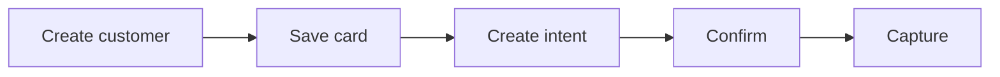

Charge a saved card using payment intents. Use the two-step create and confirm flow when you want control over when funds are taken, or Create Charge to do it in one call.

## How it works



## Before you begin

- A QA API key. See [Authentication](/get-started/authentication).
- A customer. See the [Quickstart](/get-started/quickstart) to create one.

## Charge the customer

<Steps>
  <Step title="Make sure the customer has a default card">
    When you retrieve a customer, the response includes a `save_card` link where the customer can securely save a card. Check whether they're ready to be charged with Default Card Status.

    {/* TODO: link "Default Card Status" to its API reference page once the OpenAPI spec is added. */}
  </Step>
  <Step title="Create a payment intent">
    An intent represents your intention to collect an amount from the customer for a job.

    Set `auto_capture` to `true` to charge immediately on confirmation, or `false` to place a hold and capture later, for example after the job completes.

    ```bash cURL
    curl -X POST https://qa-payments.mygigsters.com.au/api/v1/customer/create-intent/{customer_id} \
      -u "YOUR_UUID:YOUR_SECRET" \
      -H "idempotency-Key: yb174dc0-281b-4cd3-847e-d3791a84f3ab" \
      -H "X-API-Version: 1.2" \
      -H "Content-Type: application/json" \
      -d '{ "amount": 150.00, "job_id": "job_8842", "auto_capture": false }'
    ```
  </Step>
  <Step title="Confirm the intent">
    Confirming attempts payment against the customer's default card.

    {/* TODO: paste the Confirm Intent request and response from the API reference. */}
  </Step>
  <Step title="Capture, if not auto-captured">
    When you're ready to take the funds, capture the intent for the full or a partial amount.

    If the job falls through, cancel with Cancel Intent. Check the state at any time with Retrieve Intent.

    {/* TODO: paste the Capture Intent request and response from the API reference. */}
  </Step>
</Steps>

<Tip>
  If you don't need the hold and capture pattern, Create Charge creates and processes the payment in a single request.
</Tip>

## Next steps

<Columns cols={2}>
  <Card title="Payment intent lifecycle" icon="arrows-spin" href="/concepts/payment-intent-lifecycle">
    See every state an intent can be in.
  </Card>
  <Card title="Issue refunds" icon="rotate-left" href="/guides/refunds">
    Refund a payment you've captured.
  </Card>
</Columns>
