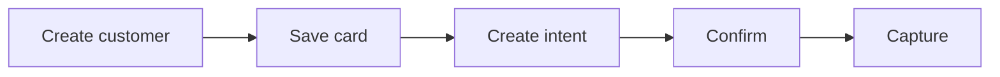

Charge a saved card using payment intents. Use the two-step create and confirm flow when you want control over when funds are taken, or Create Charge to do it in one call.

## How it works



## Before you begin

- A QA API key. See [Authentication](/get-started/authentication).
- A customer. See the [Quickstart](/get-started/quickstart) to create one.

## Charge the customer

<Steps>
  <Step title="Make sure the customer has a default card">
    When you retrieve a customer, the response includes a `save_card` link where the customer can securely save a card. Check whether they're ready to be charged with [Default card status](/api-reference/cards/default-card-status).

    To collect the card inside your own page instead, use the [Card SDK](/sdks/card-sdk).
  </Step>
  <Step title="Create a payment intent">
    An intent represents your intention to collect an amount from the customer for a job. See [Create intent](/api-reference/payment-intents/create-intent).

    Set `auto_capture` to `true` to charge immediately on confirmation, or `false` to place a hold and capture later, for example after the job completes.

    <CodeGroup>
    ```bash cURL
    curl -X POST https://qa-payments.mygigsters.com.au/api/v1/customer/create-intent/{customer_id} \
      -u "YOUR_UUID:YOUR_SECRET" \
      -H "idempotency-Key: yb174dc0-281b-4cd3-847e-d3791a84f3ab" \
      -H "X-API-Version: 1.2" \
      -H "Content-Type: application/json" \
      -d '{ "amount": 150.00, "job_id": "job_8842", "auto_capture": false }'
    ```

    ```javascript Node.js
    const response = await fetch("https://qa-payments.mygigsters.com.au/api/v1/customer/create-intent/{customer_id}", {
      method: "POST",
      headers: {
        Authorization: "Basic " + Buffer.from("YOUR_UUID:YOUR_SECRET").toString("base64"),
        "idempotency-Key": "yb174dc0-281b-4cd3-847e-d3791a84f3ab",
        "X-API-Version": "1.2",
        "Content-Type": "application/json",
      },
      body: JSON.stringify({
        "amount": 150.0,
        "job_id": "job_8842",
        "auto_capture": false
      }),
    });

    const data = await response.json();
    console.log(data);
    ```

    ```python Python
    import requests

    response = requests.post(
        "https://qa-payments.mygigsters.com.au/api/v1/customer/create-intent/{customer_id}",
        auth=("YOUR_UUID", "YOUR_SECRET"),
        headers={
            "idempotency-Key": "yb174dc0-281b-4cd3-847e-d3791a84f3ab",
            "X-API-Version": "1.2",
        },
        json={
            "amount": 150.0,
            "job_id": "job_8842",
            "auto_capture": False,
        },
    )

    print(response.json())
    ```

    ```ruby Ruby
    require "net/http"
    require "json"
    require "uri"

    uri = URI("https://qa-payments.mygigsters.com.au/api/v1/customer/create-intent/{customer_id}")
    request = Net::HTTP::Post.new(uri)
    request.basic_auth("YOUR_UUID", "YOUR_SECRET")
    request["idempotency-Key"] = "yb174dc0-281b-4cd3-847e-d3791a84f3ab"
    request["X-API-Version"] = "1.2"
    request["Content-Type"] = "application/json"
    request.body = <<~JSON
      {
        "amount": 150.0,
        "job_id": "job_8842",
        "auto_capture": false
      }
    JSON

    response = Net::HTTP.start(uri.hostname, uri.port, use_ssl: true) do |http|
      http.request(request)
    end

    puts JSON.parse(response.body)
    ```

    ```php PHP
    <?php

    $ch = curl_init("https://qa-payments.mygigsters.com.au/api/v1/customer/create-intent/{customer_id}");

    curl_setopt_array($ch, [
        CURLOPT_RETURNTRANSFER => true,
        CURLOPT_CUSTOMREQUEST => "POST",
        CURLOPT_USERPWD => "YOUR_UUID:YOUR_SECRET",
        CURLOPT_HTTPHEADER => [
            "idempotency-Key: yb174dc0-281b-4cd3-847e-d3791a84f3ab",
            "X-API-Version: 1.2",
            "Content-Type: application/json",
        ],
        CURLOPT_POSTFIELDS => <<<'JSON'
    {
      "amount": 150.0,
      "job_id": "job_8842",
      "auto_capture": false
    }
    JSON,
    ]);

    $response = curl_exec($ch);
    curl_close($ch);

    print_r(json_decode($response, true));
    ```

    ```java Java
    import java.net.URI;
    import java.net.http.HttpClient;
    import java.net.http.HttpRequest;
    import java.net.http.HttpResponse;
    import java.util.Base64;

    public class Example {
        public static void main(String[] args) throws Exception {
            String credentials = Base64.getEncoder()
                .encodeToString("YOUR_UUID:YOUR_SECRET".getBytes());

            String body = String.join("\n",
                "{",
                "  \"amount\": 150.0,",
                "  \"job_id\": \"job_8842\",",
                "  \"auto_capture\": false",
                "}"
            );

            HttpRequest request = HttpRequest.newBuilder()
                .uri(URI.create("https://qa-payments.mygigsters.com.au/api/v1/customer/create-intent/{customer_id}"))
                .header("Authorization", "Basic " + credentials)
                .header("idempotency-Key", "yb174dc0-281b-4cd3-847e-d3791a84f3ab")
                .header("X-API-Version", "1.2")
                .header("Content-Type", "application/json")
                .method("POST", HttpRequest.BodyPublishers.ofString(body))
                .build();

            HttpResponse<String> response = HttpClient.newHttpClient()
                .send(request, HttpResponse.BodyHandlers.ofString());

            System.out.println(response.body());
        }
    }
    ```

    ```go Go
    package main

    import (
    	"fmt"
    	"io"
    	"net/http"
    	"strings"
    )

    func main() {
    	body := strings.NewReader(`{
      "amount": 150.0,
      "job_id": "job_8842",
      "auto_capture": false
    }`)

    	req, err := http.NewRequest("POST", "https://qa-payments.mygigsters.com.au/api/v1/customer/create-intent/{customer_id}", body)
    	if err != nil {
    		panic(err)
    	}
    	req.SetBasicAuth("YOUR_UUID", "YOUR_SECRET")
    	req.Header.Set("idempotency-Key", "yb174dc0-281b-4cd3-847e-d3791a84f3ab")
    	req.Header.Set("X-API-Version", "1.2")
    	req.Header.Set("Content-Type", "application/json")

    	res, err := http.DefaultClient.Do(req)
    	if err != nil {
    		panic(err)
    	}
    	defer res.Body.Close()

    	data, _ := io.ReadAll(res.Body)
    	fmt.Println(string(data))
    }
    ```

    ```csharp .NET
    using System.Net.Http.Headers;
    using System.Text;

    using var client = new HttpClient();

    var request = new HttpRequestMessage(HttpMethod.Post, "https://qa-payments.mygigsters.com.au/api/v1/customer/create-intent/{customer_id}");
    request.Headers.Authorization = new AuthenticationHeaderValue(
        "Basic", Convert.ToBase64String(Encoding.UTF8.GetBytes("YOUR_UUID:YOUR_SECRET")));
    request.Headers.Add("idempotency-Key", "yb174dc0-281b-4cd3-847e-d3791a84f3ab");
    request.Headers.Add("X-API-Version", "1.2");
    request.Content = new StringContent(@"{
      ""amount"": 150.0,
      ""job_id"": ""job_8842"",
      ""auto_capture"": false
    }", Encoding.UTF8, "application/json");

    var response = await client.SendAsync(request);
    Console.WriteLine(await response.Content.ReadAsStringAsync());
    ```
    </CodeGroup>
  </Step>
  <Step title="Confirm the intent">
    Confirming attempts payment against the customer's default card.

    <CodeGroup>
    ```bash cURL
    curl -X POST https://qa-payments.mygigsters.com.au/api/v1/customer/confirm-intent/{customer_id} \
      -u "YOUR_UUID:YOUR_SECRET" \
      -H "idempotency-Key: 7b80a149-16ff-4dc8-8eb1-f1f4cfd0d577" \
      -H "X-API-Version: 1.2" \
      -H "Content-Type: application/json" \
      -d '{ "intent_id": "int_hkdmzwzw6h6nmtxbe2u", "auto_capture": false }'
    ```

    ```javascript Node.js
    const response = await fetch("https://qa-payments.mygigsters.com.au/api/v1/customer/confirm-intent/{customer_id}", {
      method: "POST",
      headers: {
        Authorization: "Basic " + Buffer.from("YOUR_UUID:YOUR_SECRET").toString("base64"),
        "idempotency-Key": "7b80a149-16ff-4dc8-8eb1-f1f4cfd0d577",
        "X-API-Version": "1.2",
        "Content-Type": "application/json",
      },
      body: JSON.stringify({
        "intent_id": "int_hkdmzwzw6h6nmtxbe2u",
        "auto_capture": false
      }),
    });

    const data = await response.json();
    console.log(data);
    ```

    ```python Python
    import requests

    response = requests.post(
        "https://qa-payments.mygigsters.com.au/api/v1/customer/confirm-intent/{customer_id}",
        auth=("YOUR_UUID", "YOUR_SECRET"),
        headers={
            "idempotency-Key": "7b80a149-16ff-4dc8-8eb1-f1f4cfd0d577",
            "X-API-Version": "1.2",
        },
        json={
            "intent_id": "int_hkdmzwzw6h6nmtxbe2u",
            "auto_capture": False,
        },
    )

    print(response.json())
    ```

    ```ruby Ruby
    require "net/http"
    require "json"
    require "uri"

    uri = URI("https://qa-payments.mygigsters.com.au/api/v1/customer/confirm-intent/{customer_id}")
    request = Net::HTTP::Post.new(uri)
    request.basic_auth("YOUR_UUID", "YOUR_SECRET")
    request["idempotency-Key"] = "7b80a149-16ff-4dc8-8eb1-f1f4cfd0d577"
    request["X-API-Version"] = "1.2"
    request["Content-Type"] = "application/json"
    request.body = <<~JSON
      {
        "intent_id": "int_hkdmzwzw6h6nmtxbe2u",
        "auto_capture": false
      }
    JSON

    response = Net::HTTP.start(uri.hostname, uri.port, use_ssl: true) do |http|
      http.request(request)
    end

    puts JSON.parse(response.body)
    ```

    ```php PHP
    <?php

    $ch = curl_init("https://qa-payments.mygigsters.com.au/api/v1/customer/confirm-intent/{customer_id}");

    curl_setopt_array($ch, [
        CURLOPT_RETURNTRANSFER => true,
        CURLOPT_CUSTOMREQUEST => "POST",
        CURLOPT_USERPWD => "YOUR_UUID:YOUR_SECRET",
        CURLOPT_HTTPHEADER => [
            "idempotency-Key: 7b80a149-16ff-4dc8-8eb1-f1f4cfd0d577",
            "X-API-Version: 1.2",
            "Content-Type: application/json",
        ],
        CURLOPT_POSTFIELDS => <<<'JSON'
    {
      "intent_id": "int_hkdmzwzw6h6nmtxbe2u",
      "auto_capture": false
    }
    JSON,
    ]);

    $response = curl_exec($ch);
    curl_close($ch);

    print_r(json_decode($response, true));
    ```

    ```java Java
    import java.net.URI;
    import java.net.http.HttpClient;
    import java.net.http.HttpRequest;
    import java.net.http.HttpResponse;
    import java.util.Base64;

    public class Example {
        public static void main(String[] args) throws Exception {
            String credentials = Base64.getEncoder()
                .encodeToString("YOUR_UUID:YOUR_SECRET".getBytes());

            String body = String.join("\n",
                "{",
                "  \"intent_id\": \"int_hkdmzwzw6h6nmtxbe2u\",",
                "  \"auto_capture\": false",
                "}"
            );

            HttpRequest request = HttpRequest.newBuilder()
                .uri(URI.create("https://qa-payments.mygigsters.com.au/api/v1/customer/confirm-intent/{customer_id}"))
                .header("Authorization", "Basic " + credentials)
                .header("idempotency-Key", "7b80a149-16ff-4dc8-8eb1-f1f4cfd0d577")
                .header("X-API-Version", "1.2")
                .header("Content-Type", "application/json")
                .method("POST", HttpRequest.BodyPublishers.ofString(body))
                .build();

            HttpResponse<String> response = HttpClient.newHttpClient()
                .send(request, HttpResponse.BodyHandlers.ofString());

            System.out.println(response.body());
        }
    }
    ```

    ```go Go
    package main

    import (
    	"fmt"
    	"io"
    	"net/http"
    	"strings"
    )

    func main() {
    	body := strings.NewReader(`{
      "intent_id": "int_hkdmzwzw6h6nmtxbe2u",
      "auto_capture": false
    }`)

    	req, err := http.NewRequest("POST", "https://qa-payments.mygigsters.com.au/api/v1/customer/confirm-intent/{customer_id}", body)
    	if err != nil {
    		panic(err)
    	}
    	req.SetBasicAuth("YOUR_UUID", "YOUR_SECRET")
    	req.Header.Set("idempotency-Key", "7b80a149-16ff-4dc8-8eb1-f1f4cfd0d577")
    	req.Header.Set("X-API-Version", "1.2")
    	req.Header.Set("Content-Type", "application/json")

    	res, err := http.DefaultClient.Do(req)
    	if err != nil {
    		panic(err)
    	}
    	defer res.Body.Close()

    	data, _ := io.ReadAll(res.Body)
    	fmt.Println(string(data))
    }
    ```

    ```csharp .NET
    using System.Net.Http.Headers;
    using System.Text;

    using var client = new HttpClient();

    var request = new HttpRequestMessage(HttpMethod.Post, "https://qa-payments.mygigsters.com.au/api/v1/customer/confirm-intent/{customer_id}");
    request.Headers.Authorization = new AuthenticationHeaderValue(
        "Basic", Convert.ToBase64String(Encoding.UTF8.GetBytes("YOUR_UUID:YOUR_SECRET")));
    request.Headers.Add("idempotency-Key", "7b80a149-16ff-4dc8-8eb1-f1f4cfd0d577");
    request.Headers.Add("X-API-Version", "1.2");
    request.Content = new StringContent(@"{
      ""intent_id"": ""int_hkdmzwzw6h6nmtxbe2u"",
      ""auto_capture"": false
    }", Encoding.UTF8, "application/json");

    var response = await client.SendAsync(request);
    Console.WriteLine(await response.Content.ReadAsStringAsync());
    ```
    </CodeGroup>

    See [Confirm intent](/api-reference/payment-intents/confirm-intent).
  </Step>
  <Step title="Capture, if not auto-captured">
    When you're ready to take the funds, capture the intent for the full or a partial amount.

    <CodeGroup>
    ```bash cURL
    curl -X POST https://qa-payments.mygigsters.com.au/api/v1/customer/capture-intent \
      -u "YOUR_UUID:YOUR_SECRET" \
      -H "idempotency-Key: 7b80a149-16ff-4dc8-8eb1-f1f4cfd0d578" \
      -H "X-API-Version: 1.2" \
      -H "Content-Type: application/json" \
      -d '{ "amount": 250, "currency": "AUD", "intent_id": "int_hkdmzwzw6h6nmtxbe2u" }'
    ```

    ```javascript Node.js
    const response = await fetch("https://qa-payments.mygigsters.com.au/api/v1/customer/capture-intent", {
      method: "POST",
      headers: {
        Authorization: "Basic " + Buffer.from("YOUR_UUID:YOUR_SECRET").toString("base64"),
        "idempotency-Key": "7b80a149-16ff-4dc8-8eb1-f1f4cfd0d578",
        "X-API-Version": "1.2",
        "Content-Type": "application/json",
      },
      body: JSON.stringify({
        "amount": 250,
        "currency": "AUD",
        "intent_id": "int_hkdmzwzw6h6nmtxbe2u"
      }),
    });

    const data = await response.json();
    console.log(data);
    ```

    ```python Python
    import requests

    response = requests.post(
        "https://qa-payments.mygigsters.com.au/api/v1/customer/capture-intent",
        auth=("YOUR_UUID", "YOUR_SECRET"),
        headers={
            "idempotency-Key": "7b80a149-16ff-4dc8-8eb1-f1f4cfd0d578",
            "X-API-Version": "1.2",
        },
        json={
            "amount": 250,
            "currency": "AUD",
            "intent_id": "int_hkdmzwzw6h6nmtxbe2u",
        },
    )

    print(response.json())
    ```

    ```ruby Ruby
    require "net/http"
    require "json"
    require "uri"

    uri = URI("https://qa-payments.mygigsters.com.au/api/v1/customer/capture-intent")
    request = Net::HTTP::Post.new(uri)
    request.basic_auth("YOUR_UUID", "YOUR_SECRET")
    request["idempotency-Key"] = "7b80a149-16ff-4dc8-8eb1-f1f4cfd0d578"
    request["X-API-Version"] = "1.2"
    request["Content-Type"] = "application/json"
    request.body = <<~JSON
      {
        "amount": 250,
        "currency": "AUD",
        "intent_id": "int_hkdmzwzw6h6nmtxbe2u"
      }
    JSON

    response = Net::HTTP.start(uri.hostname, uri.port, use_ssl: true) do |http|
      http.request(request)
    end

    puts JSON.parse(response.body)
    ```

    ```php PHP
    <?php

    $ch = curl_init("https://qa-payments.mygigsters.com.au/api/v1/customer/capture-intent");

    curl_setopt_array($ch, [
        CURLOPT_RETURNTRANSFER => true,
        CURLOPT_CUSTOMREQUEST => "POST",
        CURLOPT_USERPWD => "YOUR_UUID:YOUR_SECRET",
        CURLOPT_HTTPHEADER => [
            "idempotency-Key: 7b80a149-16ff-4dc8-8eb1-f1f4cfd0d578",
            "X-API-Version: 1.2",
            "Content-Type: application/json",
        ],
        CURLOPT_POSTFIELDS => <<<'JSON'
    {
      "amount": 250,
      "currency": "AUD",
      "intent_id": "int_hkdmzwzw6h6nmtxbe2u"
    }
    JSON,
    ]);

    $response = curl_exec($ch);
    curl_close($ch);

    print_r(json_decode($response, true));
    ```

    ```java Java
    import java.net.URI;
    import java.net.http.HttpClient;
    import java.net.http.HttpRequest;
    import java.net.http.HttpResponse;
    import java.util.Base64;

    public class Example {
        public static void main(String[] args) throws Exception {
            String credentials = Base64.getEncoder()
                .encodeToString("YOUR_UUID:YOUR_SECRET".getBytes());

            String body = String.join("\n",
                "{",
                "  \"amount\": 250,",
                "  \"currency\": \"AUD\",",
                "  \"intent_id\": \"int_hkdmzwzw6h6nmtxbe2u\"",
                "}"
            );

            HttpRequest request = HttpRequest.newBuilder()
                .uri(URI.create("https://qa-payments.mygigsters.com.au/api/v1/customer/capture-intent"))
                .header("Authorization", "Basic " + credentials)
                .header("idempotency-Key", "7b80a149-16ff-4dc8-8eb1-f1f4cfd0d578")
                .header("X-API-Version", "1.2")
                .header("Content-Type", "application/json")
                .method("POST", HttpRequest.BodyPublishers.ofString(body))
                .build();

            HttpResponse<String> response = HttpClient.newHttpClient()
                .send(request, HttpResponse.BodyHandlers.ofString());

            System.out.println(response.body());
        }
    }
    ```

    ```go Go
    package main

    import (
    	"fmt"
    	"io"
    	"net/http"
    	"strings"
    )

    func main() {
    	body := strings.NewReader(`{
      "amount": 250,
      "currency": "AUD",
      "intent_id": "int_hkdmzwzw6h6nmtxbe2u"
    }`)

    	req, err := http.NewRequest("POST", "https://qa-payments.mygigsters.com.au/api/v1/customer/capture-intent", body)
    	if err != nil {
    		panic(err)
    	}
    	req.SetBasicAuth("YOUR_UUID", "YOUR_SECRET")
    	req.Header.Set("idempotency-Key", "7b80a149-16ff-4dc8-8eb1-f1f4cfd0d578")
    	req.Header.Set("X-API-Version", "1.2")
    	req.Header.Set("Content-Type", "application/json")

    	res, err := http.DefaultClient.Do(req)
    	if err != nil {
    		panic(err)
    	}
    	defer res.Body.Close()

    	data, _ := io.ReadAll(res.Body)
    	fmt.Println(string(data))
    }
    ```

    ```csharp .NET
    using System.Net.Http.Headers;
    using System.Text;

    using var client = new HttpClient();

    var request = new HttpRequestMessage(HttpMethod.Post, "https://qa-payments.mygigsters.com.au/api/v1/customer/capture-intent");
    request.Headers.Authorization = new AuthenticationHeaderValue(
        "Basic", Convert.ToBase64String(Encoding.UTF8.GetBytes("YOUR_UUID:YOUR_SECRET")));
    request.Headers.Add("idempotency-Key", "7b80a149-16ff-4dc8-8eb1-f1f4cfd0d578");
    request.Headers.Add("X-API-Version", "1.2");
    request.Content = new StringContent(@"{
      ""amount"": 250,
      ""currency"": ""AUD"",
      ""intent_id"": ""int_hkdmzwzw6h6nmtxbe2u""
    }", Encoding.UTF8, "application/json");

    var response = await client.SendAsync(request);
    Console.WriteLine(await response.Content.ReadAsStringAsync());
    ```
    </CodeGroup>

    If the job falls through, cancel with [Cancel intent](/api-reference/payment-intents/cancel-intent). Check the state at any time with [Retrieve intent](/api-reference/payment-intents/retrieve-intent).
  </Step>
</Steps>

<Tip>
  If you don't need the hold and capture pattern, [Create charge](/api-reference/payment-intents/create-charge) creates and processes the payment in a single request.
</Tip>

## Next steps

<Columns cols={2}>
  <Card title="Payment intent lifecycle" icon="arrows-spin" href="/concepts/payment-intent-lifecycle">
    See every state an intent can be in.
  </Card>
  <Card title="Issue refunds" icon="rotate-left" href="/guides/refunds">
    Refund a payment you've captured.
  </Card>
</Columns>
