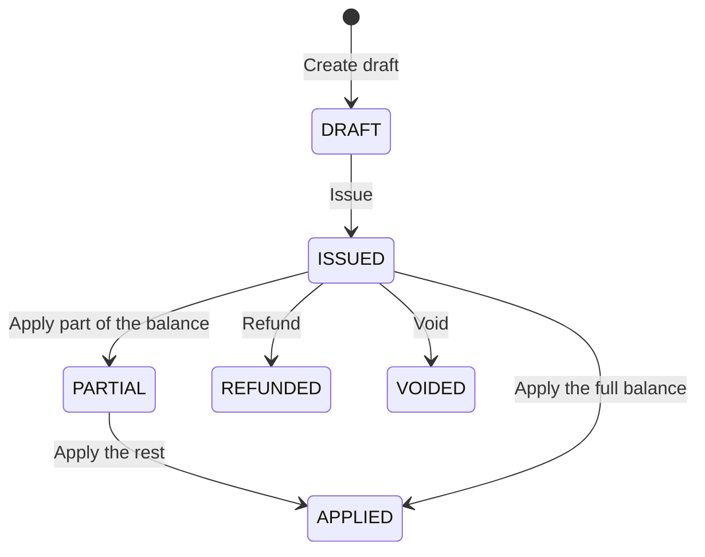

A credit note reduces what a customer owes on an invoice. You draft it, review it, issue it, and then allocate its balance across the customer's invoices.

## Credit note states



| State | What it means |
|---|---|
| `DRAFT` | Uncommitted record. Can be updated or permanently deleted. The balance isn't usable yet. |
| `ISSUED` | Locked from edits. A sequential credit note number is generated and the full balance is available to allocate. |
| `PARTIAL` | Part of the balance has been allocated. The rest can still offset future invoices. |
| `APPLIED` | The whole balance has been allocated. The remaining balance is zero. |
| `REFUNDED` | The balance was refunded to the customer's payment method. |
| `VOIDED` | Permanently revoked with a recorded reason. The balance is removed immediately. |

## Issue and apply a credit note

<Steps>
  <Step title="Create a draft">
    Create a draft against an invoice. Send the `invoice_id`, the credit `amount`, and a `reason`. `currency` and `description` are optional. A draft stays editable and doesn't change any balances until you issue it.

    ```bash
    curl -X POST https://qa-payments.mygigsters.com.au/api/v1/credit-notes/draft \
      -u "YOUR_UUID:YOUR_SECRET" \
      -H "idempotency-Key: cn-req-draft-001" \
      -H "X-API-Version: 1.2" \
      -H "Content-Type: application/json" \
      -d '{
        "invoice_id": "24de1b2b-6875-4cca-927d-2ad3c4d564b5",
        "amount": 100.00,
        "currency": "AUD",
        "reason": "Customer discount / Service dispute",
        "description": "100 AUD credit issued for overbilled service hours"
      }'
    ```

    See [Create draft credit note](/api-reference/credit-notes/create-draft-credit-note).
  </Step>
  <Step title="Review, update, or discard the draft">
    Before issuing, change the amount or reason with [Update draft credit note](/api-reference/credit-notes/update-draft-credit-note), or discard the draft with [Delete draft credit note](/api-reference/credit-notes/delete-draft-credit-note).

    ```bash
    curl -X PUT https://qa-payments.mygigsters.com.au/api/v1/credit-notes/3/draft \
      -u "YOUR_UUID:YOUR_SECRET" \
      -H "idempotency-Key: cn-req-edit-002" \
      -H "X-API-Version: 1.2" \
      -H "Content-Type: application/json" \
      -d '{
        "amount": 150.00,
        "currency": "AUD",
        "reason": "Customer discount / Service dispute",
        "description": "150 AUD credit issued for overbilled service hours"
      }'
    ```
  </Step>
  <Step title="Issue the credit note">
    Issuing moves the credit note from `DRAFT` to `ISSUED`. It:

    - locks the credit note from further edits
    - assigns a sequential code, for example `CN-2026-0089`
    - makes the full credit amount available to settle invoices
    - generates the PDF, which you can fetch with [Download credit note PDF](/api-reference/credit-notes/download-credit-note)

    ```bash
    curl -X POST https://qa-payments.mygigsters.com.au/api/v1/credit-notes/3/issue \
      -u "YOUR_UUID:YOUR_SECRET" \
      -H "idempotency-Key: cn-req-issue-003" \
      -H "X-API-Version: 1.2" \
      -H "Content-Type: application/json"
    ```
  </Step>
  <Step title="Apply the credit to an invoice">
    Allocate credit to reduce the amount due on an unpaid invoice. Send the `amount` and `invoice_id`, with optional `notes`. If you use the whole balance, the credit note becomes fully applied. Otherwise it stays partially applied until the rest is used.

    ```bash
    curl -X POST https://qa-payments.mygigsters.com.au/api/v1/credit-notes/1/apply \
      -u "YOUR_UUID:YOUR_SECRET" \
      -H "idempotency-Key: cn-req-apply-004" \
      -H "X-API-Version: 1.2" \
      -H "Content-Type: application/json" \
      -d '{
        "amount": 15.00,
        "invoice_id": "669dc683-4ad1-4971-a743-90d908788f01",
        "notes": "Applying partial credit to invoice INV-4717"
      }'
    ```

    See [Apply credit note](/api-reference/credit-notes/apply-credit-note) and [Get allocations](/api-reference/credit-notes/get-credit-note-allocations).
  </Step>
</Steps>

## Refund a credit note

Instead of applying the balance to an invoice, you can return it to the customer's payment method with [Refund credit note](/api-reference/credit-notes/refund-credit-note).

## Void a credit note

If a credit note was issued by mistake, void it. Voiding revokes any unapplied balance, records the reason, and sets the status to `VOIDED`.

```bash
curl -X POST https://qa-payments.mygigsters.com.au/api/v1/credit-notes/1/void \
  -u "YOUR_UUID:YOUR_SECRET" \
  -H "idempotency-Key: cn-req-void-005" \
  -H "X-API-Version: 1.2" \
  -H "Content-Type: application/json" \
  -d '{
    "reason": "Credit note issued by mistake"
  }'
```

<Tip>
  To create and issue in one flow, call [Create draft credit note](/api-reference/credit-notes/create-draft-credit-note) and follow it immediately with [Issue credit note](/api-reference/credit-notes/issue-credit-note). Query credit notes in any state with [List credit notes](/api-reference/credit-notes/list-credit-notes).
</Tip>
