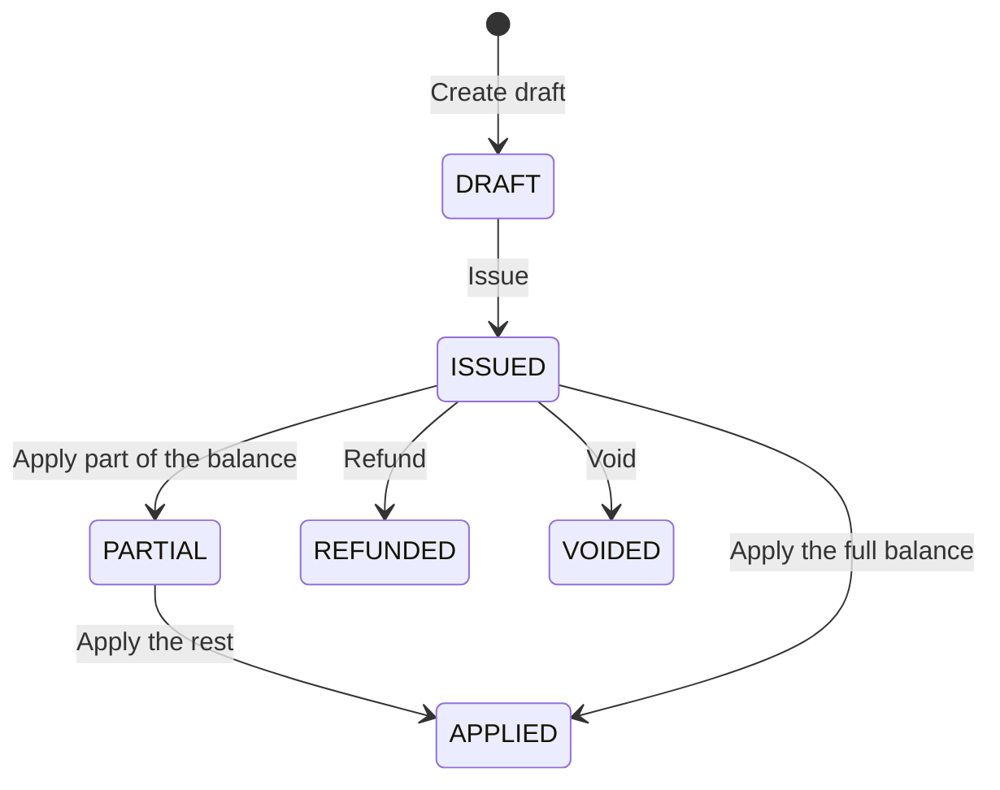

A credit note reduces what a customer owes on an invoice. You draft it, review it, issue it, and then allocate its balance across the customer's invoices.

## Credit note states



| State | What it means |
|---|---|
| `DRAFT` | Uncommitted record. Can be updated or permanently deleted. The balance isn't usable yet. |
| `ISSUED` | Locked from edits. A sequential credit note number is generated and the full balance is available to allocate. |
| `PARTIAL` | Part of the balance has been allocated. The rest can still offset future invoices. |
| `APPLIED` | The whole balance has been allocated. The remaining balance is zero. |
| `REFUNDED` | The balance was refunded to the customer's payment method. |
| `VOIDED` | Permanently revoked with a recorded reason. The balance is removed immediately. |

## Issue and apply a credit note

<Steps>
  <Step title="Create a draft">
    Create a draft against an invoice. Send the `invoice_id`, the credit `amount`, and a `reason`. `currency` and `description` are optional. A draft stays editable and doesn't change any balances until you issue it.

    <CodeGroup>
    ```bash cURL
    curl -X POST https://qa-payments.mygigsters.com.au/api/v1/credit-notes/draft \
      -u "YOUR_UUID:YOUR_SECRET" \
      -H "idempotency-Key: cn-req-draft-001" \
      -H "X-API-Version: 1.2" \
      -H "Content-Type: application/json" \
      -d '{
        "invoice_id": "24de1b2b-6875-4cca-927d-2ad3c4d564b5",
        "amount": 100.00,
        "currency": "AUD",
        "reason": "Customer discount / Service dispute",
        "description": "100 AUD credit issued for overbilled service hours"
      }'
    ```

    ```javascript Node.js
    const response = await fetch("https://qa-payments.mygigsters.com.au/api/v1/credit-notes/draft", {
      method: "POST",
      headers: {
        Authorization: "Basic " + Buffer.from("YOUR_UUID:YOUR_SECRET").toString("base64"),
        "idempotency-Key": "cn-req-draft-001",
        "X-API-Version": "1.2",
        "Content-Type": "application/json",
      },
      body: JSON.stringify({
        "invoice_id": "24de1b2b-6875-4cca-927d-2ad3c4d564b5",
        "amount": 100.0,
        "currency": "AUD",
        "reason": "Customer discount / Service dispute",
        "description": "100 AUD credit issued for overbilled service hours"
      }),
    });

    const data = await response.json();
    console.log(data);
    ```

    ```python Python
    import requests

    response = requests.post(
        "https://qa-payments.mygigsters.com.au/api/v1/credit-notes/draft",
        auth=("YOUR_UUID", "YOUR_SECRET"),
        headers={
            "idempotency-Key": "cn-req-draft-001",
            "X-API-Version": "1.2",
        },
        json={
            "invoice_id": "24de1b2b-6875-4cca-927d-2ad3c4d564b5",
            "amount": 100.0,
            "currency": "AUD",
            "reason": "Customer discount / Service dispute",
            "description": "100 AUD credit issued for overbilled service hours",
        },
    )

    print(response.json())
    ```

    ```ruby Ruby
    require "net/http"
    require "json"
    require "uri"

    uri = URI("https://qa-payments.mygigsters.com.au/api/v1/credit-notes/draft")
    request = Net::HTTP::Post.new(uri)
    request.basic_auth("YOUR_UUID", "YOUR_SECRET")
    request["idempotency-Key"] = "cn-req-draft-001"
    request["X-API-Version"] = "1.2"
    request["Content-Type"] = "application/json"
    request.body = <<~JSON
      {
        "invoice_id": "24de1b2b-6875-4cca-927d-2ad3c4d564b5",
        "amount": 100.0,
        "currency": "AUD",
        "reason": "Customer discount / Service dispute",
        "description": "100 AUD credit issued for overbilled service hours"
      }
    JSON

    response = Net::HTTP.start(uri.hostname, uri.port, use_ssl: true) do |http|
      http.request(request)
    end

    puts JSON.parse(response.body)
    ```

    ```php PHP
    <?php

    $ch = curl_init("https://qa-payments.mygigsters.com.au/api/v1/credit-notes/draft");

    curl_setopt_array($ch, [
        CURLOPT_RETURNTRANSFER => true,
        CURLOPT_CUSTOMREQUEST => "POST",
        CURLOPT_USERPWD => "YOUR_UUID:YOUR_SECRET",
        CURLOPT_HTTPHEADER => [
            "idempotency-Key: cn-req-draft-001",
            "X-API-Version: 1.2",
            "Content-Type: application/json",
        ],
        CURLOPT_POSTFIELDS => <<<'JSON'
    {
      "invoice_id": "24de1b2b-6875-4cca-927d-2ad3c4d564b5",
      "amount": 100.0,
      "currency": "AUD",
      "reason": "Customer discount / Service dispute",
      "description": "100 AUD credit issued for overbilled service hours"
    }
    JSON,
    ]);

    $response = curl_exec($ch);
    curl_close($ch);

    print_r(json_decode($response, true));
    ```

    ```java Java
    import java.net.URI;
    import java.net.http.HttpClient;
    import java.net.http.HttpRequest;
    import java.net.http.HttpResponse;
    import java.util.Base64;

    public class Example {
        public static void main(String[] args) throws Exception {
            String credentials = Base64.getEncoder()
                .encodeToString("YOUR_UUID:YOUR_SECRET".getBytes());

            String body = String.join("\n",
                "{",
                "  \"invoice_id\": \"24de1b2b-6875-4cca-927d-2ad3c4d564b5\",",
                "  \"amount\": 100.0,",
                "  \"currency\": \"AUD\",",
                "  \"reason\": \"Customer discount / Service dispute\",",
                "  \"description\": \"100 AUD credit issued for overbilled service hours\"",
                "}"
            );

            HttpRequest request = HttpRequest.newBuilder()
                .uri(URI.create("https://qa-payments.mygigsters.com.au/api/v1/credit-notes/draft"))
                .header("Authorization", "Basic " + credentials)
                .header("idempotency-Key", "cn-req-draft-001")
                .header("X-API-Version", "1.2")
                .header("Content-Type", "application/json")
                .method("POST", HttpRequest.BodyPublishers.ofString(body))
                .build();

            HttpResponse<String> response = HttpClient.newHttpClient()
                .send(request, HttpResponse.BodyHandlers.ofString());

            System.out.println(response.body());
        }
    }
    ```

    ```go Go
    package main

    import (
    	"fmt"
    	"io"
    	"net/http"
    	"strings"
    )

    func main() {
    	body := strings.NewReader(`{
      "invoice_id": "24de1b2b-6875-4cca-927d-2ad3c4d564b5",
      "amount": 100.0,
      "currency": "AUD",
      "reason": "Customer discount / Service dispute",
      "description": "100 AUD credit issued for overbilled service hours"
    }`)

    	req, err := http.NewRequest("POST", "https://qa-payments.mygigsters.com.au/api/v1/credit-notes/draft", body)
    	if err != nil {
    		panic(err)
    	}
    	req.SetBasicAuth("YOUR_UUID", "YOUR_SECRET")
    	req.Header.Set("idempotency-Key", "cn-req-draft-001")
    	req.Header.Set("X-API-Version", "1.2")
    	req.Header.Set("Content-Type", "application/json")

    	res, err := http.DefaultClient.Do(req)
    	if err != nil {
    		panic(err)
    	}
    	defer res.Body.Close()

    	data, _ := io.ReadAll(res.Body)
    	fmt.Println(string(data))
    }
    ```

    ```csharp .NET
    using System.Net.Http.Headers;
    using System.Text;

    using var client = new HttpClient();

    var request = new HttpRequestMessage(HttpMethod.Post, "https://qa-payments.mygigsters.com.au/api/v1/credit-notes/draft");
    request.Headers.Authorization = new AuthenticationHeaderValue(
        "Basic", Convert.ToBase64String(Encoding.UTF8.GetBytes("YOUR_UUID:YOUR_SECRET")));
    request.Headers.Add("idempotency-Key", "cn-req-draft-001");
    request.Headers.Add("X-API-Version", "1.2");
    request.Content = new StringContent(@"{
      ""invoice_id"": ""24de1b2b-6875-4cca-927d-2ad3c4d564b5"",
      ""amount"": 100.0,
      ""currency"": ""AUD"",
      ""reason"": ""Customer discount / Service dispute"",
      ""description"": ""100 AUD credit issued for overbilled service hours""
    }", Encoding.UTF8, "application/json");

    var response = await client.SendAsync(request);
    Console.WriteLine(await response.Content.ReadAsStringAsync());
    ```
    </CodeGroup>

    See [Create draft credit note](/api-reference/credit-notes/create-draft-credit-note).
  </Step>
  <Step title="Review, update, or discard the draft">
    Before issuing, change the amount or reason with [Update draft credit note](/api-reference/credit-notes/update-draft-credit-note), or discard the draft with [Delete draft credit note](/api-reference/credit-notes/delete-draft-credit-note).

    <CodeGroup>
    ```bash cURL
    curl -X PUT https://qa-payments.mygigsters.com.au/api/v1/credit-notes/3/draft \
      -u "YOUR_UUID:YOUR_SECRET" \
      -H "idempotency-Key: cn-req-edit-002" \
      -H "X-API-Version: 1.2" \
      -H "Content-Type: application/json" \
      -d '{
        "amount": 150.00,
        "currency": "AUD",
        "reason": "Customer discount / Service dispute",
        "description": "150 AUD credit issued for overbilled service hours"
      }'
    ```

    ```javascript Node.js
    const response = await fetch("https://qa-payments.mygigsters.com.au/api/v1/credit-notes/3/draft", {
      method: "PUT",
      headers: {
        Authorization: "Basic " + Buffer.from("YOUR_UUID:YOUR_SECRET").toString("base64"),
        "idempotency-Key": "cn-req-edit-002",
        "X-API-Version": "1.2",
        "Content-Type": "application/json",
      },
      body: JSON.stringify({
        "amount": 150.0,
        "currency": "AUD",
        "reason": "Customer discount / Service dispute",
        "description": "150 AUD credit issued for overbilled service hours"
      }),
    });

    const data = await response.json();
    console.log(data);
    ```

    ```python Python
    import requests

    response = requests.put(
        "https://qa-payments.mygigsters.com.au/api/v1/credit-notes/3/draft",
        auth=("YOUR_UUID", "YOUR_SECRET"),
        headers={
            "idempotency-Key": "cn-req-edit-002",
            "X-API-Version": "1.2",
        },
        json={
            "amount": 150.0,
            "currency": "AUD",
            "reason": "Customer discount / Service dispute",
            "description": "150 AUD credit issued for overbilled service hours",
        },
    )

    print(response.json())
    ```

    ```ruby Ruby
    require "net/http"
    require "json"
    require "uri"

    uri = URI("https://qa-payments.mygigsters.com.au/api/v1/credit-notes/3/draft")
    request = Net::HTTP::Put.new(uri)
    request.basic_auth("YOUR_UUID", "YOUR_SECRET")
    request["idempotency-Key"] = "cn-req-edit-002"
    request["X-API-Version"] = "1.2"
    request["Content-Type"] = "application/json"
    request.body = <<~JSON
      {
        "amount": 150.0,
        "currency": "AUD",
        "reason": "Customer discount / Service dispute",
        "description": "150 AUD credit issued for overbilled service hours"
      }
    JSON

    response = Net::HTTP.start(uri.hostname, uri.port, use_ssl: true) do |http|
      http.request(request)
    end

    puts JSON.parse(response.body)
    ```

    ```php PHP
    <?php

    $ch = curl_init("https://qa-payments.mygigsters.com.au/api/v1/credit-notes/3/draft");

    curl_setopt_array($ch, [
        CURLOPT_RETURNTRANSFER => true,
        CURLOPT_CUSTOMREQUEST => "PUT",
        CURLOPT_USERPWD => "YOUR_UUID:YOUR_SECRET",
        CURLOPT_HTTPHEADER => [
            "idempotency-Key: cn-req-edit-002",
            "X-API-Version: 1.2",
            "Content-Type: application/json",
        ],
        CURLOPT_POSTFIELDS => <<<'JSON'
    {
      "amount": 150.0,
      "currency": "AUD",
      "reason": "Customer discount / Service dispute",
      "description": "150 AUD credit issued for overbilled service hours"
    }
    JSON,
    ]);

    $response = curl_exec($ch);
    curl_close($ch);

    print_r(json_decode($response, true));
    ```

    ```java Java
    import java.net.URI;
    import java.net.http.HttpClient;
    import java.net.http.HttpRequest;
    import java.net.http.HttpResponse;
    import java.util.Base64;

    public class Example {
        public static void main(String[] args) throws Exception {
            String credentials = Base64.getEncoder()
                .encodeToString("YOUR_UUID:YOUR_SECRET".getBytes());

            String body = String.join("\n",
                "{",
                "  \"amount\": 150.0,",
                "  \"currency\": \"AUD\",",
                "  \"reason\": \"Customer discount / Service dispute\",",
                "  \"description\": \"150 AUD credit issued for overbilled service hours\"",
                "}"
            );

            HttpRequest request = HttpRequest.newBuilder()
                .uri(URI.create("https://qa-payments.mygigsters.com.au/api/v1/credit-notes/3/draft"))
                .header("Authorization", "Basic " + credentials)
                .header("idempotency-Key", "cn-req-edit-002")
                .header("X-API-Version", "1.2")
                .header("Content-Type", "application/json")
                .method("PUT", HttpRequest.BodyPublishers.ofString(body))
                .build();

            HttpResponse<String> response = HttpClient.newHttpClient()
                .send(request, HttpResponse.BodyHandlers.ofString());

            System.out.println(response.body());
        }
    }
    ```

    ```go Go
    package main

    import (
    	"fmt"
    	"io"
    	"net/http"
    	"strings"
    )

    func main() {
    	body := strings.NewReader(`{
      "amount": 150.0,
      "currency": "AUD",
      "reason": "Customer discount / Service dispute",
      "description": "150 AUD credit issued for overbilled service hours"
    }`)

    	req, err := http.NewRequest("PUT", "https://qa-payments.mygigsters.com.au/api/v1/credit-notes/3/draft", body)
    	if err != nil {
    		panic(err)
    	}
    	req.SetBasicAuth("YOUR_UUID", "YOUR_SECRET")
    	req.Header.Set("idempotency-Key", "cn-req-edit-002")
    	req.Header.Set("X-API-Version", "1.2")
    	req.Header.Set("Content-Type", "application/json")

    	res, err := http.DefaultClient.Do(req)
    	if err != nil {
    		panic(err)
    	}
    	defer res.Body.Close()

    	data, _ := io.ReadAll(res.Body)
    	fmt.Println(string(data))
    }
    ```

    ```csharp .NET
    using System.Net.Http.Headers;
    using System.Text;

    using var client = new HttpClient();

    var request = new HttpRequestMessage(HttpMethod.Put, "https://qa-payments.mygigsters.com.au/api/v1/credit-notes/3/draft");
    request.Headers.Authorization = new AuthenticationHeaderValue(
        "Basic", Convert.ToBase64String(Encoding.UTF8.GetBytes("YOUR_UUID:YOUR_SECRET")));
    request.Headers.Add("idempotency-Key", "cn-req-edit-002");
    request.Headers.Add("X-API-Version", "1.2");
    request.Content = new StringContent(@"{
      ""amount"": 150.0,
      ""currency"": ""AUD"",
      ""reason"": ""Customer discount / Service dispute"",
      ""description"": ""150 AUD credit issued for overbilled service hours""
    }", Encoding.UTF8, "application/json");

    var response = await client.SendAsync(request);
    Console.WriteLine(await response.Content.ReadAsStringAsync());
    ```
    </CodeGroup>
  </Step>
  <Step title="Issue the credit note">
    Issuing moves the credit note from `DRAFT` to `ISSUED`. It:

    - locks the credit note from further edits
    - assigns a sequential code, for example `CN-2026-0089`
    - makes the full credit amount available to settle invoices
    - generates the PDF, which you can fetch with [Download credit note PDF](/api-reference/credit-notes/download-credit-note)

    <CodeGroup>
    ```bash cURL
    curl -X POST https://qa-payments.mygigsters.com.au/api/v1/credit-notes/3/issue \
      -u "YOUR_UUID:YOUR_SECRET" \
      -H "idempotency-Key: cn-req-issue-003" \
      -H "X-API-Version: 1.2" \
      -H "Content-Type: application/json"
    ```

    ```javascript Node.js
    const response = await fetch("https://qa-payments.mygigsters.com.au/api/v1/credit-notes/3/issue", {
      method: "POST",
      headers: {
        Authorization: "Basic " + Buffer.from("YOUR_UUID:YOUR_SECRET").toString("base64"),
        "idempotency-Key": "cn-req-issue-003",
        "X-API-Version": "1.2",
        "Content-Type": "application/json",
      },
    });

    const data = await response.json();
    console.log(data);
    ```

    ```python Python
    import requests

    response = requests.post(
        "https://qa-payments.mygigsters.com.au/api/v1/credit-notes/3/issue",
        auth=("YOUR_UUID", "YOUR_SECRET"),
        headers={
            "idempotency-Key": "cn-req-issue-003",
            "X-API-Version": "1.2",
            "Content-Type": "application/json",
        },
    )

    print(response.json())
    ```

    ```ruby Ruby
    require "net/http"
    require "json"
    require "uri"

    uri = URI("https://qa-payments.mygigsters.com.au/api/v1/credit-notes/3/issue")
    request = Net::HTTP::Post.new(uri)
    request.basic_auth("YOUR_UUID", "YOUR_SECRET")
    request["idempotency-Key"] = "cn-req-issue-003"
    request["X-API-Version"] = "1.2"
    request["Content-Type"] = "application/json"

    response = Net::HTTP.start(uri.hostname, uri.port, use_ssl: true) do |http|
      http.request(request)
    end

    puts JSON.parse(response.body)
    ```

    ```php PHP
    <?php

    $ch = curl_init("https://qa-payments.mygigsters.com.au/api/v1/credit-notes/3/issue");

    curl_setopt_array($ch, [
        CURLOPT_RETURNTRANSFER => true,
        CURLOPT_CUSTOMREQUEST => "POST",
        CURLOPT_USERPWD => "YOUR_UUID:YOUR_SECRET",
        CURLOPT_HTTPHEADER => [
            "idempotency-Key: cn-req-issue-003",
            "X-API-Version: 1.2",
            "Content-Type: application/json",
        ],
    ]);

    $response = curl_exec($ch);
    curl_close($ch);

    print_r(json_decode($response, true));
    ```

    ```java Java
    import java.net.URI;
    import java.net.http.HttpClient;
    import java.net.http.HttpRequest;
    import java.net.http.HttpResponse;
    import java.util.Base64;

    public class Example {
        public static void main(String[] args) throws Exception {
            String credentials = Base64.getEncoder()
                .encodeToString("YOUR_UUID:YOUR_SECRET".getBytes());

            HttpRequest request = HttpRequest.newBuilder()
                .uri(URI.create("https://qa-payments.mygigsters.com.au/api/v1/credit-notes/3/issue"))
                .header("Authorization", "Basic " + credentials)
                .header("idempotency-Key", "cn-req-issue-003")
                .header("X-API-Version", "1.2")
                .header("Content-Type", "application/json")
                .method("POST", HttpRequest.BodyPublishers.noBody())
                .build();

            HttpResponse<String> response = HttpClient.newHttpClient()
                .send(request, HttpResponse.BodyHandlers.ofString());

            System.out.println(response.body());
        }
    }
    ```

    ```go Go
    package main

    import (
    	"fmt"
    	"io"
    	"net/http"
    )

    func main() {
    	req, err := http.NewRequest("POST", "https://qa-payments.mygigsters.com.au/api/v1/credit-notes/3/issue", nil)
    	if err != nil {
    		panic(err)
    	}
    	req.SetBasicAuth("YOUR_UUID", "YOUR_SECRET")
    	req.Header.Set("idempotency-Key", "cn-req-issue-003")
    	req.Header.Set("X-API-Version", "1.2")
    	req.Header.Set("Content-Type", "application/json")

    	res, err := http.DefaultClient.Do(req)
    	if err != nil {
    		panic(err)
    	}
    	defer res.Body.Close()

    	data, _ := io.ReadAll(res.Body)
    	fmt.Println(string(data))
    }
    ```

    ```csharp .NET
    using System.Net.Http.Headers;
    using System.Text;

    using var client = new HttpClient();

    var request = new HttpRequestMessage(HttpMethod.Post, "https://qa-payments.mygigsters.com.au/api/v1/credit-notes/3/issue");
    request.Headers.Authorization = new AuthenticationHeaderValue(
        "Basic", Convert.ToBase64String(Encoding.UTF8.GetBytes("YOUR_UUID:YOUR_SECRET")));
    request.Headers.Add("idempotency-Key", "cn-req-issue-003");
    request.Headers.Add("X-API-Version", "1.2");

    var response = await client.SendAsync(request);
    Console.WriteLine(await response.Content.ReadAsStringAsync());
    ```
    </CodeGroup>
  </Step>
  <Step title="Apply the credit to an invoice">
    Allocate credit to reduce the amount due on an unpaid invoice. Send the `amount` and `invoice_id`, with optional `notes`. If you use the whole balance, the credit note becomes fully applied. Otherwise it stays partially applied until the rest is used.

    <CodeGroup>
    ```bash cURL
    curl -X POST https://qa-payments.mygigsters.com.au/api/v1/credit-notes/1/apply \
      -u "YOUR_UUID:YOUR_SECRET" \
      -H "idempotency-Key: cn-req-apply-004" \
      -H "X-API-Version: 1.2" \
      -H "Content-Type: application/json" \
      -d '{
        "amount": 15.00,
        "invoice_id": "669dc683-4ad1-4971-a743-90d908788f01",
        "notes": "Applying partial credit to invoice INV-4717"
      }'
    ```

    ```javascript Node.js
    const response = await fetch("https://qa-payments.mygigsters.com.au/api/v1/credit-notes/1/apply", {
      method: "POST",
      headers: {
        Authorization: "Basic " + Buffer.from("YOUR_UUID:YOUR_SECRET").toString("base64"),
        "idempotency-Key": "cn-req-apply-004",
        "X-API-Version": "1.2",
        "Content-Type": "application/json",
      },
      body: JSON.stringify({
        "amount": 15.0,
        "invoice_id": "669dc683-4ad1-4971-a743-90d908788f01",
        "notes": "Applying partial credit to invoice INV-4717"
      }),
    });

    const data = await response.json();
    console.log(data);
    ```

    ```python Python
    import requests

    response = requests.post(
        "https://qa-payments.mygigsters.com.au/api/v1/credit-notes/1/apply",
        auth=("YOUR_UUID", "YOUR_SECRET"),
        headers={
            "idempotency-Key": "cn-req-apply-004",
            "X-API-Version": "1.2",
        },
        json={
            "amount": 15.0,
            "invoice_id": "669dc683-4ad1-4971-a743-90d908788f01",
            "notes": "Applying partial credit to invoice INV-4717",
        },
    )

    print(response.json())
    ```

    ```ruby Ruby
    require "net/http"
    require "json"
    require "uri"

    uri = URI("https://qa-payments.mygigsters.com.au/api/v1/credit-notes/1/apply")
    request = Net::HTTP::Post.new(uri)
    request.basic_auth("YOUR_UUID", "YOUR_SECRET")
    request["idempotency-Key"] = "cn-req-apply-004"
    request["X-API-Version"] = "1.2"
    request["Content-Type"] = "application/json"
    request.body = <<~JSON
      {
        "amount": 15.0,
        "invoice_id": "669dc683-4ad1-4971-a743-90d908788f01",
        "notes": "Applying partial credit to invoice INV-4717"
      }
    JSON

    response = Net::HTTP.start(uri.hostname, uri.port, use_ssl: true) do |http|
      http.request(request)
    end

    puts JSON.parse(response.body)
    ```

    ```php PHP
    <?php

    $ch = curl_init("https://qa-payments.mygigsters.com.au/api/v1/credit-notes/1/apply");

    curl_setopt_array($ch, [
        CURLOPT_RETURNTRANSFER => true,
        CURLOPT_CUSTOMREQUEST => "POST",
        CURLOPT_USERPWD => "YOUR_UUID:YOUR_SECRET",
        CURLOPT_HTTPHEADER => [
            "idempotency-Key: cn-req-apply-004",
            "X-API-Version: 1.2",
            "Content-Type: application/json",
        ],
        CURLOPT_POSTFIELDS => <<<'JSON'
    {
      "amount": 15.0,
      "invoice_id": "669dc683-4ad1-4971-a743-90d908788f01",
      "notes": "Applying partial credit to invoice INV-4717"
    }
    JSON,
    ]);

    $response = curl_exec($ch);
    curl_close($ch);

    print_r(json_decode($response, true));
    ```

    ```java Java
    import java.net.URI;
    import java.net.http.HttpClient;
    import java.net.http.HttpRequest;
    import java.net.http.HttpResponse;
    import java.util.Base64;

    public class Example {
        public static void main(String[] args) throws Exception {
            String credentials = Base64.getEncoder()
                .encodeToString("YOUR_UUID:YOUR_SECRET".getBytes());

            String body = String.join("\n",
                "{",
                "  \"amount\": 15.0,",
                "  \"invoice_id\": \"669dc683-4ad1-4971-a743-90d908788f01\",",
                "  \"notes\": \"Applying partial credit to invoice INV-4717\"",
                "}"
            );

            HttpRequest request = HttpRequest.newBuilder()
                .uri(URI.create("https://qa-payments.mygigsters.com.au/api/v1/credit-notes/1/apply"))
                .header("Authorization", "Basic " + credentials)
                .header("idempotency-Key", "cn-req-apply-004")
                .header("X-API-Version", "1.2")
                .header("Content-Type", "application/json")
                .method("POST", HttpRequest.BodyPublishers.ofString(body))
                .build();

            HttpResponse<String> response = HttpClient.newHttpClient()
                .send(request, HttpResponse.BodyHandlers.ofString());

            System.out.println(response.body());
        }
    }
    ```

    ```go Go
    package main

    import (
    	"fmt"
    	"io"
    	"net/http"
    	"strings"
    )

    func main() {
    	body := strings.NewReader(`{
      "amount": 15.0,
      "invoice_id": "669dc683-4ad1-4971-a743-90d908788f01",
      "notes": "Applying partial credit to invoice INV-4717"
    }`)

    	req, err := http.NewRequest("POST", "https://qa-payments.mygigsters.com.au/api/v1/credit-notes/1/apply", body)
    	if err != nil {
    		panic(err)
    	}
    	req.SetBasicAuth("YOUR_UUID", "YOUR_SECRET")
    	req.Header.Set("idempotency-Key", "cn-req-apply-004")
    	req.Header.Set("X-API-Version", "1.2")
    	req.Header.Set("Content-Type", "application/json")

    	res, err := http.DefaultClient.Do(req)
    	if err != nil {
    		panic(err)
    	}
    	defer res.Body.Close()

    	data, _ := io.ReadAll(res.Body)
    	fmt.Println(string(data))
    }
    ```

    ```csharp .NET
    using System.Net.Http.Headers;
    using System.Text;

    using var client = new HttpClient();

    var request = new HttpRequestMessage(HttpMethod.Post, "https://qa-payments.mygigsters.com.au/api/v1/credit-notes/1/apply");
    request.Headers.Authorization = new AuthenticationHeaderValue(
        "Basic", Convert.ToBase64String(Encoding.UTF8.GetBytes("YOUR_UUID:YOUR_SECRET")));
    request.Headers.Add("idempotency-Key", "cn-req-apply-004");
    request.Headers.Add("X-API-Version", "1.2");
    request.Content = new StringContent(@"{
      ""amount"": 15.0,
      ""invoice_id"": ""669dc683-4ad1-4971-a743-90d908788f01"",
      ""notes"": ""Applying partial credit to invoice INV-4717""
    }", Encoding.UTF8, "application/json");

    var response = await client.SendAsync(request);
    Console.WriteLine(await response.Content.ReadAsStringAsync());
    ```
    </CodeGroup>

    See [Apply credit note](/api-reference/credit-notes/apply-credit-note) and [Get allocations](/api-reference/credit-notes/get-credit-note-allocations).
  </Step>
</Steps>

## Refund a credit note

Instead of applying the balance to an invoice, you can return it to the customer's payment method with [Refund credit note](/api-reference/credit-notes/refund-credit-note).

## Void a credit note

If a credit note was issued by mistake, void it. Voiding revokes any unapplied balance, records the reason, and sets the status to `VOIDED`.

<CodeGroup>
```bash cURL
curl -X POST https://qa-payments.mygigsters.com.au/api/v1/credit-notes/1/void \
  -u "YOUR_UUID:YOUR_SECRET" \
  -H "idempotency-Key: cn-req-void-005" \
  -H "X-API-Version: 1.2" \
  -H "Content-Type: application/json" \
  -d '{
    "reason": "Credit note issued by mistake"
  }'
```

```javascript Node.js
const response = await fetch("https://qa-payments.mygigsters.com.au/api/v1/credit-notes/1/void", {
  method: "POST",
  headers: {
    Authorization: "Basic " + Buffer.from("YOUR_UUID:YOUR_SECRET").toString("base64"),
    "idempotency-Key": "cn-req-void-005",
    "X-API-Version": "1.2",
    "Content-Type": "application/json",
  },
  body: JSON.stringify({
    "reason": "Credit note issued by mistake"
  }),
});

const data = await response.json();
console.log(data);
```

```python Python
import requests

response = requests.post(
    "https://qa-payments.mygigsters.com.au/api/v1/credit-notes/1/void",
    auth=("YOUR_UUID", "YOUR_SECRET"),
    headers={
        "idempotency-Key": "cn-req-void-005",
        "X-API-Version": "1.2",
    },
    json={
        "reason": "Credit note issued by mistake",
    },
)

print(response.json())
```

```ruby Ruby
require "net/http"
require "json"
require "uri"

uri = URI("https://qa-payments.mygigsters.com.au/api/v1/credit-notes/1/void")
request = Net::HTTP::Post.new(uri)
request.basic_auth("YOUR_UUID", "YOUR_SECRET")
request["idempotency-Key"] = "cn-req-void-005"
request["X-API-Version"] = "1.2"
request["Content-Type"] = "application/json"
request.body = <<~JSON
  {
    "reason": "Credit note issued by mistake"
  }
JSON

response = Net::HTTP.start(uri.hostname, uri.port, use_ssl: true) do |http|
  http.request(request)
end

puts JSON.parse(response.body)
```

```php PHP
<?php

$ch = curl_init("https://qa-payments.mygigsters.com.au/api/v1/credit-notes/1/void");

curl_setopt_array($ch, [
    CURLOPT_RETURNTRANSFER => true,
    CURLOPT_CUSTOMREQUEST => "POST",
    CURLOPT_USERPWD => "YOUR_UUID:YOUR_SECRET",
    CURLOPT_HTTPHEADER => [
        "idempotency-Key: cn-req-void-005",
        "X-API-Version: 1.2",
        "Content-Type: application/json",
    ],
    CURLOPT_POSTFIELDS => <<<'JSON'
{
  "reason": "Credit note issued by mistake"
}
JSON,
]);

$response = curl_exec($ch);
curl_close($ch);

print_r(json_decode($response, true));
```

```java Java
import java.net.URI;
import java.net.http.HttpClient;
import java.net.http.HttpRequest;
import java.net.http.HttpResponse;
import java.util.Base64;

public class Example {
    public static void main(String[] args) throws Exception {
        String credentials = Base64.getEncoder()
            .encodeToString("YOUR_UUID:YOUR_SECRET".getBytes());

        String body = String.join("\n",
            "{",
            "  \"reason\": \"Credit note issued by mistake\"",
            "}"
        );

        HttpRequest request = HttpRequest.newBuilder()
            .uri(URI.create("https://qa-payments.mygigsters.com.au/api/v1/credit-notes/1/void"))
            .header("Authorization", "Basic " + credentials)
            .header("idempotency-Key", "cn-req-void-005")
            .header("X-API-Version", "1.2")
            .header("Content-Type", "application/json")
            .method("POST", HttpRequest.BodyPublishers.ofString(body))
            .build();

        HttpResponse<String> response = HttpClient.newHttpClient()
            .send(request, HttpResponse.BodyHandlers.ofString());

        System.out.println(response.body());
    }
}
```

```go Go
package main

import (
	"fmt"
	"io"
	"net/http"
	"strings"
)

func main() {
	body := strings.NewReader(`{
  "reason": "Credit note issued by mistake"
}`)

	req, err := http.NewRequest("POST", "https://qa-payments.mygigsters.com.au/api/v1/credit-notes/1/void", body)
	if err != nil {
		panic(err)
	}
	req.SetBasicAuth("YOUR_UUID", "YOUR_SECRET")
	req.Header.Set("idempotency-Key", "cn-req-void-005")
	req.Header.Set("X-API-Version", "1.2")
	req.Header.Set("Content-Type", "application/json")

	res, err := http.DefaultClient.Do(req)
	if err != nil {
		panic(err)
	}
	defer res.Body.Close()

	data, _ := io.ReadAll(res.Body)
	fmt.Println(string(data))
}
```

```csharp .NET
using System.Net.Http.Headers;
using System.Text;

using var client = new HttpClient();

var request = new HttpRequestMessage(HttpMethod.Post, "https://qa-payments.mygigsters.com.au/api/v1/credit-notes/1/void");
request.Headers.Authorization = new AuthenticationHeaderValue(
    "Basic", Convert.ToBase64String(Encoding.UTF8.GetBytes("YOUR_UUID:YOUR_SECRET")));
request.Headers.Add("idempotency-Key", "cn-req-void-005");
request.Headers.Add("X-API-Version", "1.2");
request.Content = new StringContent(@"{
  ""reason"": ""Credit note issued by mistake""
}", Encoding.UTF8, "application/json");

var response = await client.SendAsync(request);
Console.WriteLine(await response.Content.ReadAsStringAsync());
```
</CodeGroup>

<Tip>
  To create and issue in one flow, call [Create draft credit note](/api-reference/credit-notes/create-draft-credit-note) and follow it immediately with [Issue credit note](/api-reference/credit-notes/issue-credit-note). Query credit notes in any state with [List credit notes](/api-reference/credit-notes/list-credit-notes).
</Tip>
