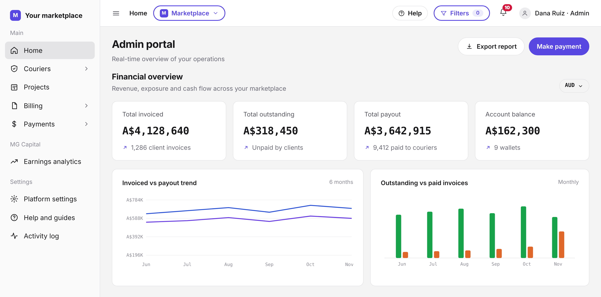
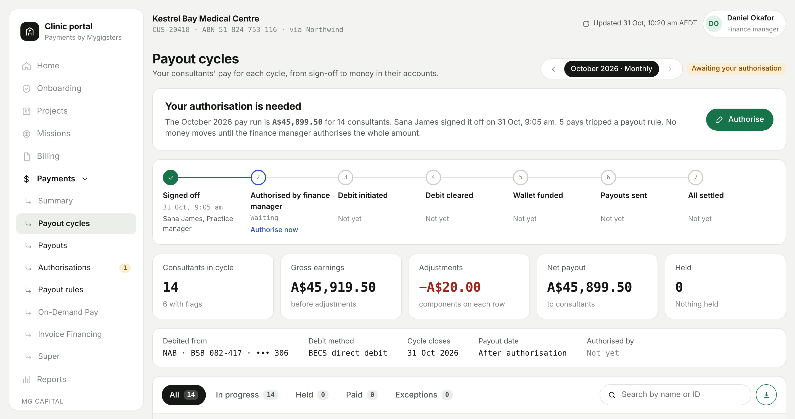
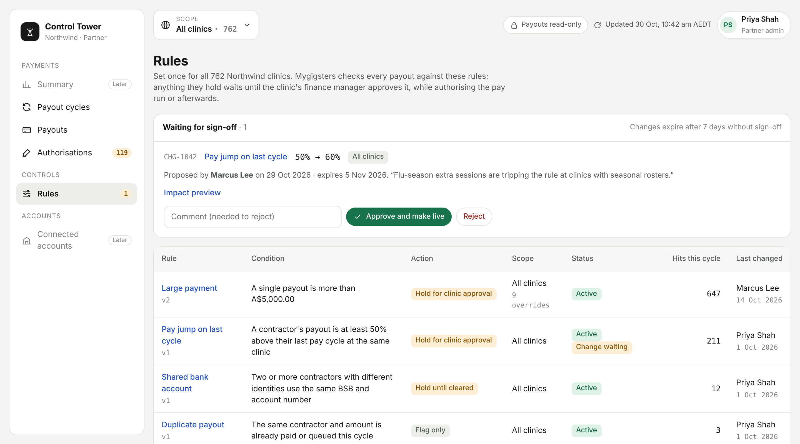

## Build with MyGigsters

MyGigsters gives marketplaces the payment plumbing they need: take money from customers, pay workers, issue invoices, and verify the people doing the work.

Use the Payments API when your marketplace sits between the people who pay for work and the people who do it, and you need to move money between them without building payments infrastructure yourself. SaaS businesses use the same API to collect and pay out inside their own product, and vertical SaaS providers and fintech companies partner with us to offer it to their own customers.

<Frame caption="See what you've invoiced, what's outstanding, and what you've paid out, in one place.">
  
</Frame>

<Columns cols={2}>
  <Card title="Quickstart" icon="rocket" href="/get-started/quickstart">
    Make your first API request in five minutes.
  </Card>
  <Card title="How MyGigsters works" icon="diagram-project" href="/get-started/how-it-works">
    See who is involved and how money moves through your marketplace.
  </Card>
</Columns>

## Who it's for

<Columns cols={2}>
  <Card title="Marketplaces" icon="store" href="/guides/charge-a-customer">
    Charge customers for a job, then pay the worker who did it. Covers gig, talent, and on-demand service marketplaces.
  </Card>
  <Card title="SaaS businesses" icon="laptop-code" href="/guides/onboard-and-pay-a-worker">
    Add payments, invoicing, and payouts to your own software without becoming a payments company.
  </Card>
  <Card title="Vertical SaaS providers" icon="layer-group" href="/platform/overview">
    Partner with us to give the businesses in your industry their own accounts, and move money on their behalf.
  </Card>
  <Card title="Fintech companies" icon="building-columns" href="/platform/overview">
    Partner with us to onboard your customers as connected accounts and run batch payouts through your own product.
  </Card>
</Columns>

<Tip>
  Marketplaces and SaaS businesses integrate directly with an API key. Vertical SaaS providers and fintech companies integrate as partners, using a [partner account](/platform/overview).
</Tip>

## Collect payments

<Columns cols={2}>
  <Card title="Charge a customer" icon="credit-card" href="/guides/charge-a-customer">
    Save a card and take a payment with payment intents, including pre-authorisation and capture.
  </Card>
  <Card title="Send a payment link" icon="link" href="/guides/payment-links">
    Generate a hosted payment page without building a checkout.
  </Card>
  <Card title="Set up subscriptions" icon="repeat" href="/guides/subscriptions">
    Bill customers on a recurring schedule, and pause, resume, or cancel as needed.
  </Card>
  <Card title="Issue refunds" icon="rotate-left" href="/guides/refunds">
    Refund a payment and track the refund through to completion.
  </Card>
</Columns>

## Pay workers

<Frame caption="A pay run moves from sign-off to settled, with each stage tracked.">
  
</Frame>

<Columns cols={2}>
  <Card title="Onboard and pay a worker" icon="user-plus" href="/guides/onboard-and-pay-a-worker">
    Register a worker, collect their bank details, and send their first payout.
  </Card>
  <Card title="Pay many workers at once" icon="users" href="/guides/bulk-payouts">
    Send a batch of payouts in one request and track each one.
  </Card>
  <Card title="Check wallet balances" icon="wallet" href="/guides/wallet-balances">
    See available, pending, and reserved funds before you pay out.
  </Card>
  <Card title="Collect bank details securely" icon="building-columns" href="/sdks/beneficiary-sdk">
    Embed a hosted bank-account form so raw account details never touch your front end.
  </Card>
</Columns>

<Info>
  Payouts are supported to bank accounts in Australia (BSB and account number) and India (IFSC or UPI).
</Info>

## Invoice and reconcile

<Columns cols={2}>
  <Card title="Send invoices and receipts" icon="file-invoice-dollar" href="/guides/invoices-and-receipts">
    Create and email invoices with a payment link built in, and send receipts for payments and payouts.
  </Card>
  <Card title="Issue and apply credit notes" icon="file-circle-minus" href="/guides/credit-notes">
    Correct an invoice, apply the credit, or refund it to the original payment method.
  </Card>
</Columns>

## Verify your workers

<Columns cols={2}>
  <Card title="Document verification" icon="id-card" href="/guides/document-verification">
    Check ABNs, driver licences, passports, visas, vehicle registrations, and right to work.
  </Card>
  <Card title="Police checks" icon="shield" href="/guides/document-verification#police-checks">
    Start a police check and poll for the result.
  </Card>
</Columns>

## Manage your marketplace

<Frame caption="Set payout rules once and apply them across every account you manage.">
  
</Frame>

<Columns cols={2}>
  <Card title="Onboard connected accounts" icon="handshake" href="/platform/onboard-connected-accounts">
    Create accounts for the businesses you serve and track their verification status.
  </Card>
  <Card title="Embed the KYC flow" icon="wand-magic-sparkles" href="/platform/kyc-magic-link">
    Hand off identity verification with a magic link instead of building the forms.
  </Card>
  <Card title="Receive webhooks" icon="bell" href="/security/webhooks">
    Get payment and payout events in real time, with signed payloads.
  </Card>
  <Card title="Manage API keys" icon="key" href="/security/api-keys-and-rotation">
    Rotate keys with no downtime and scope restricted keys to what each integration needs.
  </Card>
</Columns>

## More resources

<Columns cols={3}>
  <Card title="API reference" icon="code" href="/api-reference/introduction">
    Every endpoint, parameter, and response.
  </Card>
  <Card title="Core objects" icon="cubes" href="/concepts/core-objects">
    How customers, workers, intents, and payouts relate.
  </Card>
  <Card title="Changelog" icon="clock-rotate-left" href="/changelog">
    What changed in each API version.
  </Card>
</Columns>

<Note>
  Questions about your integration? Email [hello@mygigsters.com.au](mailto:hello@mygigsters.com.au).
</Note>
