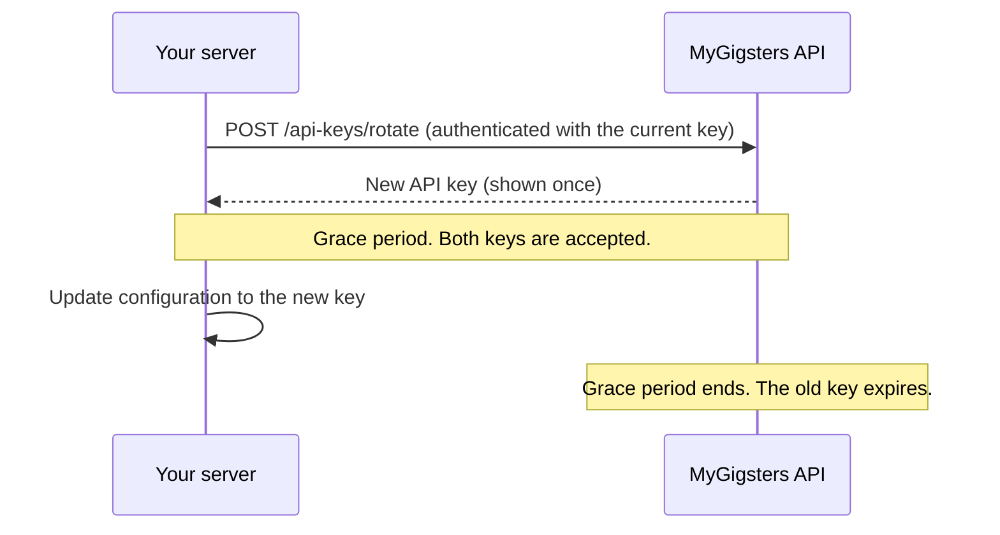

Key rotation lets you replace an API key without interrupting service. You generate a new key while the previous one stays valid for a grace period, then the old key expires automatically.

## How rotation works



<Steps>
  <Step title="Call the rotate endpoint">
    Authenticate with your existing key and call Rotate API Key. A new key is generated and the previous key is marked `Rotating`.
  </Step>
  <Step title="Switch to the new key">
    Both keys are accepted during the grace period. Update your configuration and start using the new key.
  </Step>
  <Step title="The old key expires">
    When the grace period ends, the old key becomes `Expired` and only the new key is accepted.
  </Step>
</Steps>

| Phase | Existing key | New key |
|---|---|---|
| During the grace period | Accepted | Accepted |
| After expiry | Rejected with `401` | Accepted |

## Rotate an API key

`POST /api/v1/api-keys/rotate`

Generates a new API key and marks the existing key as `Rotating`. Both keys remain valid until the grace period expires.

| Field | Type | Description |
|---|---|---|
| `id` (required) | integer | ID of the API key to rotate. |
| `reason` (optional) | string | A short label describing why the rotation was triggered. |
| `expires_at` (required) | string | The expiration time for the new API key. |

<CodeGroup>
```bash Request
curl -X POST https://qa-payments.mygigsters.com.au/api/v1/api-keys/rotate \
  -u "YOUR_UUID:YOUR_SECRET" \
  -H "X-API-Version: 1.2" \
  -H "Content-Type: application/json" \
  -d '{
  "id": 100,
  "reason": "Scheduled rotation",
  "expires_at": "2026-07-28T10:05:38.331Z"
}'
```

```json Response
{
  "success": true,
  "message": "API key rotated successfully.",
  "data": {
    "api_key": "NEW_API_KEY",
    "created_at": "2026-07-17T11:19:07.282Z",
    "old_key_expires_at": "2026-07-24"
  }
}
```
</CodeGroup>

<Warning>
  The new key is returned only in this response. Store it securely. It can't be retrieved or shown again, so if you lose it you must rotate again.
</Warning>

## List API keys

`GET /api/v1/api-keys`

Returns every API key on your account, including keys that are mid-rotation. A key's `status` is `Active`, `Rotating`, `Expired`, or `Revoked`.

<CodeGroup>
```bash Request
curl -X GET https://qa-payments.mygigsters.com.au/api/v1/api-keys \
  -u "YOUR_UUID:YOUR_SECRET" \
  -H "X-API-Version: 1.2"
```

```json Response
{
  "pagination": {
    "current_page": 1,
    "page_size": 10,
    "total_count": 2,
    "total_pages": 1
  },
  "keys": [
    {
      "id": 101,
      "uuid": "3967d9a5-c3f0-409a-a53e-0495b862fe9e",
      "name": "Rotation",
      "created_at": "2026-07-17T10:57:51.000Z",
      "expires_at": null,
      "status": "Active"
    },
    {
      "id": 100,
      "uuid": "3967d9a5-c3f0-409a-a53e-0495b862fe9e",
      "name": "Rotation",
      "created_at": "2026-07-17T10:55:44.000Z",
      "expires_at": "2026-07-24",
      "status": "Rotating"
    }
  ]
}
```
</CodeGroup>

## Revoke an API key

`DELETE /api/v1/api-keys/{id}`

Immediately revokes a key before its scheduled expiry.

<CodeGroup>
```bash cURL
curl -X DELETE https://qa-payments.mygigsters.com.au/api/v1/api-keys/87 \
  -u "YOUR_UUID:YOUR_SECRET" \
  -H "X-API-Version: 1.2"
```

```javascript Node.js
const response = await fetch("https://qa-payments.mygigsters.com.au/api/v1/api-keys/87", {
  method: "DELETE",
  headers: {
    Authorization: "Basic " + Buffer.from("YOUR_UUID:YOUR_SECRET").toString("base64"),
    "X-API-Version": "1.2",
  },
});

const data = await response.json();
console.log(data);
```

```python Python
import requests

response = requests.delete(
    "https://qa-payments.mygigsters.com.au/api/v1/api-keys/87",
    auth=("YOUR_UUID", "YOUR_SECRET"),
    headers={
        "X-API-Version": "1.2",
    },
)

print(response.json())
```

```ruby Ruby
require "net/http"
require "json"
require "uri"

uri = URI("https://qa-payments.mygigsters.com.au/api/v1/api-keys/87")
request = Net::HTTP::Delete.new(uri)
request.basic_auth("YOUR_UUID", "YOUR_SECRET")
request["X-API-Version"] = "1.2"

response = Net::HTTP.start(uri.hostname, uri.port, use_ssl: true) do |http|
  http.request(request)
end

puts JSON.parse(response.body)
```

```php PHP
<?php

$ch = curl_init("https://qa-payments.mygigsters.com.au/api/v1/api-keys/87");

curl_setopt_array($ch, [
    CURLOPT_RETURNTRANSFER => true,
    CURLOPT_CUSTOMREQUEST => "DELETE",
    CURLOPT_USERPWD => "YOUR_UUID:YOUR_SECRET",
    CURLOPT_HTTPHEADER => [
        "X-API-Version: 1.2",
    ],
]);

$response = curl_exec($ch);
curl_close($ch);

print_r(json_decode($response, true));
```

```java Java
import java.net.URI;
import java.net.http.HttpClient;
import java.net.http.HttpRequest;
import java.net.http.HttpResponse;
import java.util.Base64;

public class Example {
    public static void main(String[] args) throws Exception {
        String credentials = Base64.getEncoder()
            .encodeToString("YOUR_UUID:YOUR_SECRET".getBytes());

        HttpRequest request = HttpRequest.newBuilder()
            .uri(URI.create("https://qa-payments.mygigsters.com.au/api/v1/api-keys/87"))
            .header("Authorization", "Basic " + credentials)
            .header("X-API-Version", "1.2")
            .method("DELETE", HttpRequest.BodyPublishers.noBody())
            .build();

        HttpResponse<String> response = HttpClient.newHttpClient()
            .send(request, HttpResponse.BodyHandlers.ofString());

        System.out.println(response.body());
    }
}
```

```go Go
package main

import (
	"fmt"
	"io"
	"net/http"
)

func main() {
	req, err := http.NewRequest("DELETE", "https://qa-payments.mygigsters.com.au/api/v1/api-keys/87", nil)
	if err != nil {
		panic(err)
	}
	req.SetBasicAuth("YOUR_UUID", "YOUR_SECRET")
	req.Header.Set("X-API-Version", "1.2")

	res, err := http.DefaultClient.Do(req)
	if err != nil {
		panic(err)
	}
	defer res.Body.Close()

	data, _ := io.ReadAll(res.Body)
	fmt.Println(string(data))
}
```

```csharp .NET
using System.Net.Http.Headers;
using System.Text;

using var client = new HttpClient();

var request = new HttpRequestMessage(HttpMethod.Delete, "https://qa-payments.mygigsters.com.au/api/v1/api-keys/87");
request.Headers.Authorization = new AuthenticationHeaderValue(
    "Basic", Convert.ToBase64String(Encoding.UTF8.GetBytes("YOUR_UUID:YOUR_SECRET")));
request.Headers.Add("X-API-Version", "1.2");

var response = await client.SendAsync(request);
Console.WriteLine(await response.Content.ReadAsStringAsync());
```
</CodeGroup>

## Rules

| Rule | Description |
|---|---|
| Administrator authorisation | Only authenticated platform administrators can rotate API keys. |
| Active key required | The current API key must be valid and active. |
| Two-key limit | You can have at most two active keys during the rotation period: the current key and the new key. |
| No rotation of inactive keys | Expired or revoked keys can't be rotated. |
| Rate limiting | Rotation requests are rate limited. |

## Audit log

Every rotation action is written to your audit log.

| Event | Description |
|---|---|
| API Key Created | Initial key generated. |
| API Key Rotated | New key created from an existing key. |
| API Key Revoked | Key manually revoked. |
| API Key Expired | Grace period ended and the old key was disabled. |

## Errors

| Status | Error code | Message |
|---|---|---|
| `401` | `UNAUTHORIZED` | Invalid API key. |
| `403` | `FORBIDDEN` | You are not authorized to rotate API keys. |
| `409` | `CONFLICT` | An API key rotation is already in progress. |
| `500` | `INTERNAL_SERVER_ERROR` | Unable to rotate API key. |

```json Example error
{
  "status": 409,
  "error_code": "CONFLICT",
  "message": "An API key rotation is already in progress."
}
```
