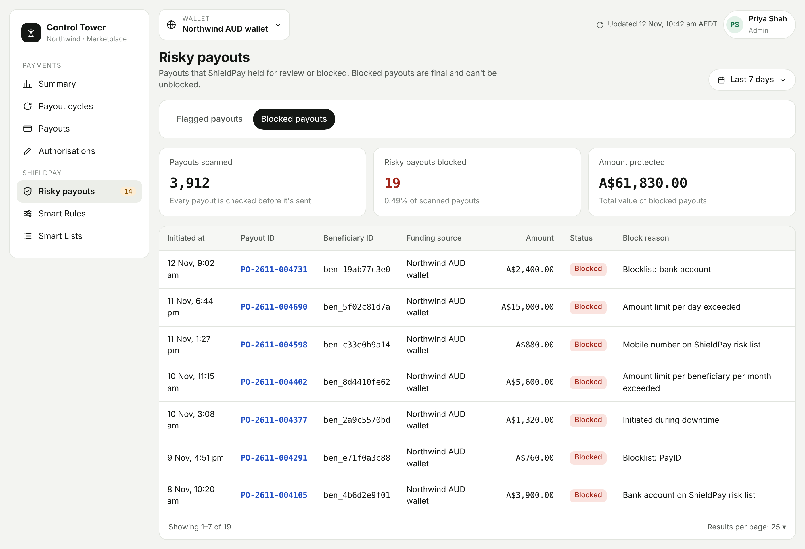

<Info>
  ShieldPay is in development and not yet available. This page describes how it will work.
</Info>

A blocked payout is one that ShieldPay stopped permanently because of possible fraud or a policy breach. No money reaches the beneficiary.

<Warning>
  A block is final. A blocked payout can't be reversed or unblocked.
</Warning>

## Why a payout is blocked

- **Anomaly detection:** the recipient is on the ShieldPay risk list of high-risk bank accounts, PayIDs, emails, and mobile numbers.
- **Smart Rules:** a rule set to reject payouts was breached, or the payout was created during downtime.
- **My blocklists:** the recipient matches an entry on a blocklist you maintain.

## Find blocked payouts

Go to **ShieldPay > Risky payouts** and select the **Blocked payouts** tab.

<Frame caption="The Blocked payouts tab.">
  
</Frame>

### Summary figures

| Figure | What it shows |
|---|---|
| Payouts scanned | Total payouts ShieldPay analysed. |
| Risky payouts blocked | Number of payouts permanently stopped. |
| Amount protected | Total value of blocked payouts. |

### Columns

Initiated at, Payout ID, Beneficiary ID, Funding source (the wallet the payout was drawn from), Amount, Status, and Block reason.

### Tools on the tab

| Tool | What it does |
|---|---|
| Date filter | Defaults to **Last 7 days**. Choose a preset or a custom date range. |
| Results per page | Change how many rows are shown. |

## Block reasons

### From the ShieldPay risk list

| Block reason | What it means |
|---|---|
| Bank account on ShieldPay risk list | The bank account is high risk. |
| High-risk PayID | The PayID is linked to an aggregator considered high risk. |
| PayID on ShieldPay risk list | The PayID is flagged as high risk. |
| Email on ShieldPay risk list | The email address is flagged as high risk. |
| Mobile number on ShieldPay risk list | The mobile number is flagged as high risk. |

### From Smart Rules

| Block reason | What it means |
|---|---|
| Amount limit per payout exceeded | The payout is over the maximum for a single payout. |
| Amount limit per day exceeded | The payout takes your wallet over its daily maximum. |
| Amount limit per month exceeded | The payout takes your wallet over its monthly maximum. |
| Amount limit per beneficiary per day exceeded | The payout takes one beneficiary over their daily maximum. |
| Amount limit per beneficiary per month exceeded | The payout takes one beneficiary over their monthly maximum. |
| Payout count limit exceeded | The payout takes one beneficiary over their daily, weekly, or monthly count. |
| Initiated during downtime | The payout was created inside your downtime window. |

A Smart Rule can hold a payout for review instead of blocking it. See [Smart Rules](/shieldpay/smart-rules#choose-what-happens-when-a-limit-is-breached).

### From your blocklists

| Block reason | What it means |
|---|---|
| Blocklist: bank account | The bank account is on your blocklist. |
| Blocklist: PayID | The PayID is on your blocklist. |
| Blocklist: email | The email address is on your blocklist. |
| Blocklist: mobile | The mobile number is on your blocklist. |
