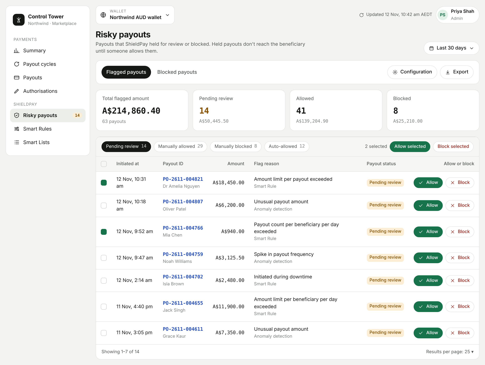
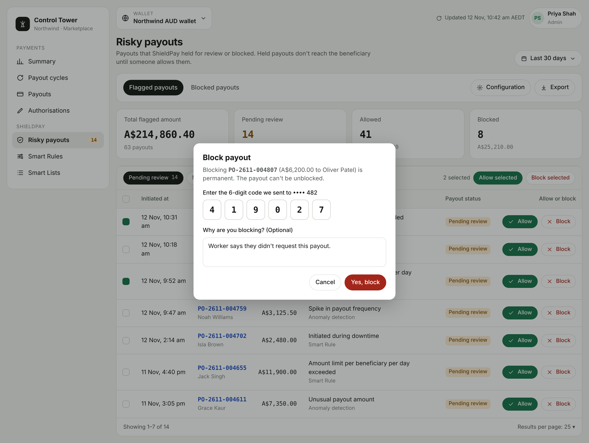
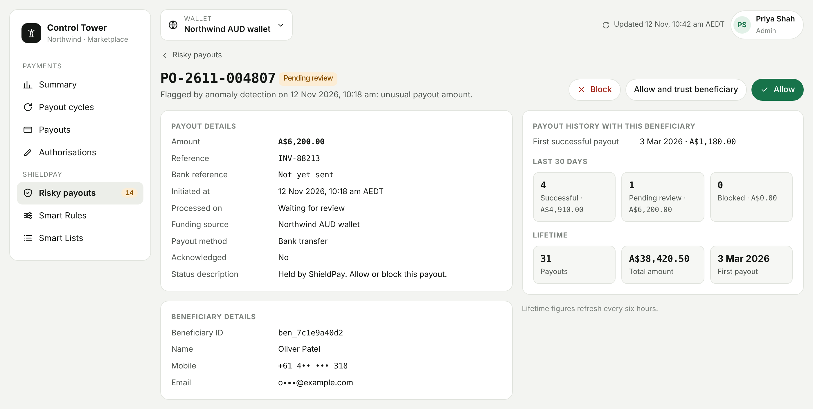

<Info>
  ShieldPay is in development and not yet available. This page describes how it will work.
</Info>

A flagged payout is one that ShieldPay considers risky and has held for a person to check. It stays pending and doesn't reach the beneficiary unless someone allows it.

## Why a payout is flagged

- **Anomaly detection** found a suspicious pattern or unusual behaviour.
- **A Smart Rule** set to request approval was breached: an amount limit, a payout count limit, or your downtime window.

## Find flagged payouts

Go to **ShieldPay > Risky payouts**. The **Flagged payouts** tab opens by default.

<Frame caption="The Flagged payouts tab.">
  
</Frame>

The top of the tab shows four figures for the selected period: **Total flagged amount**, **Pending review**, **Allowed**, and **Blocked**.

### Review categories

| Category | What it holds |
|---|---|
| Pending review | Payouts waiting for a decision. They're paused until an authorised person acts. |
| Manually allowed | Payouts a reviewer allowed. These proceed. |
| Manually blocked | Payouts a reviewer blocked. These are stopped. |
| Auto-allowed | Payouts that met your auto-allow setting. These proceed without review. |

Each category shows the total amount and number of payouts in it.

### Columns

| Column | Shown in |
|---|---|
| Initiated at | All categories |
| Payout ID | All categories |
| Amount | All categories |
| Flag reason | All categories |
| Payout status | Pending review, Manually allowed, Manually blocked |
| Allow or block | All categories. Shows the action buttons in Pending review, the person who allowed or blocked in the manual categories, and "Auto-allowed" in Auto-allowed. |

### Tools on the tab

| Tool | What it does |
|---|---|
| Date filter | Defaults to **Last 30 days**. Choose a preset or a custom date range. |
| Status filter | Filter the table by payout status. |
| Configuration | Choose whether payouts flagged by anomaly detection are kept pending for review or auto-allowed. See [Anomaly detection](/shieldpay/anomaly-detection#choose-what-happens-to-flagged-payouts). |
| Export | Download the table as a CSV file. |
| Results per page | Change how many rows are shown. |

## Allow a payout

<Steps>
  <Step title="Open Pending review">
    Find the payout in the **Pending review** category.
  </Step>
  <Step title="Select Allow">
    In the confirmation, select **Yes, allow**.
  </Step>
  <Step title="Confirm it's you">
    Enter the one-time code sent to you and select **Confirm**. You're only asked for a code once per session.
  </Step>
</Steps>

The payout moves to **Manually allowed** and is sent.

## Block a payout

<Steps>
  <Step title="Open Pending review">
    Find the payout in the **Pending review** category.
  </Step>
  <Step title="Select Block">
    Enter the one-time code sent to you and select **Confirm**.
  </Step>
  <Step title="Give a reason">
    Optionally, say why in the **Why are you blocking?** field.
  </Step>
  <Step title="Confirm">
    Select **Yes, block**.
  </Step>
</Steps>

The payout moves to **Manually blocked**.

<Frame caption="Blocking a payout.">
  
</Frame>

<Warning>
  Blocking is permanent. A blocked payout can't be unblocked. To pay the beneficiary, create a new payout.
</Warning>

## Allow or block several payouts at once

1. Open **Pending review**.
2. Select the payouts using the checkboxes on the left.
3. In the bulk action bar, select **Allow selected** or **Block selected**.
4. Enter the one-time code and confirm. If you're blocking, you can add a reason.

Allowed payouts move to **Manually allowed**. Blocked payouts move to **Manually blocked**.

## Payout details

Select a payout to open its details.

<Frame caption="A flagged payout's details.">
  
</Frame>

| Section | What it shows |
|---|---|
| Reason and date | Why and when the payout was flagged, allowed, blocked, or auto-allowed. |
| Actions | Depends on the status. While pending: **Block**, **Allow**, and **Allow and trust beneficiary**. After a decision: **Trust beneficiary**, and who allowed or blocked it, or "Auto-allowed". |
| Payout history | The first successful payout to this beneficiary. |
| Last 30 days | Number and total amount of payouts to this beneficiary, split into successful, pending review, and blocked. |
| Lifetime | Total number and amount of payouts to this beneficiary. Refreshes every six hours. |
| Payout | Payout ID and payout status. |
| Beneficiary details | Beneficiary ID, name, mobile number, and email. |
| Payout details | Bank reference, reference, initiated at, processed on, funding source, payout method, whether the beneficiary's bank acknowledged receipt, and status description. |

## What your integration sees

While a payout is held, its status is `APPROVAL_PENDING`. When a reviewer allows it, it continues through the normal payout statuses. When a reviewer blocks it, its status becomes `REJECTED` with the status code `MANUALLY_REJECTED`. See [Statuses and webhooks](/shieldpay/statuses-and-webhooks).
