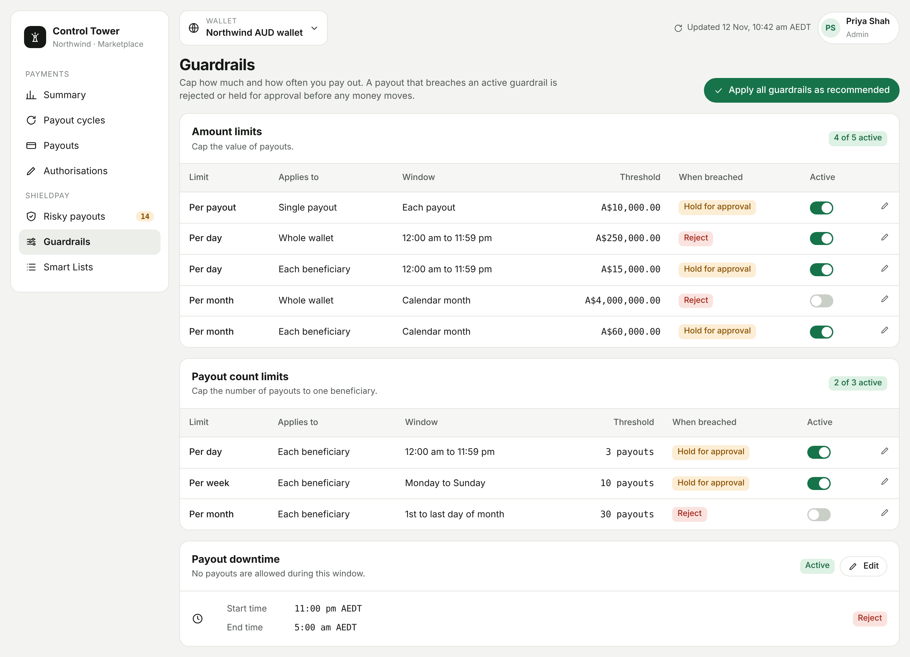

<Info>
  ShieldPay is in development and not yet available. This page describes how it will work.
</Info>

Guardrails are ShieldPay's velocity controls. They cap the number of payouts or the total amount paid within a set period, and can stop payouts entirely during hours you choose. Use them to protect against unauthorised access, excessive or duplicate payouts, and abuse by end users.

<Frame caption="Guardrails in the dashboard.">
  
</Frame>

## Apply the recommended guardrails

To get started quickly, go to **ShieldPay > Guardrails** and select **Apply all guardrails as recommended**. This turns on every recommended guardrail in one step. You can change any of them afterwards.

## Choose what happens when a limit is breached

Each guardrail has one of two actions. Unless you change it, a payout that breaches a guardrail is held for approval.

| Action | What happens |
|---|---|
| Stop payouts and request approval | The payout is held in **Flagged payouts** under **Risky payouts**. An authorised user chooses **Allow** or **Block**. This is the default. |
| Reject payouts | The payout is rejected automatically. It doesn't proceed and no review is needed. It appears under **Blocked payouts**. |

## Amount limits

Amount limits cap the value of payouts. There are five, and each has its own on/off toggle.

| Limit | Applies to | Window |
|---|---|---|
| Per payout | A single payout | Each payout |
| Per day | The total paid from your wallet | 12:00:00 am to 11:59:59 pm |
| Per day | The total paid to one beneficiary | 12:00:00 am to 11:59:59 pm |
| Per month | The total paid from your wallet | Calendar month |
| Per month | The total paid to one beneficiary | Calendar month |

To set an amount limit:

1. Go to **ShieldPay > Guardrails**.
2. Select the **Edit** icon next to the limit.
3. Enter the amount and choose the action.
4. Select **Save**.
5. Use the toggle to turn the limit on or off.

## Payout count limits

Count limits cap the number of payouts to one beneficiary. All three apply per beneficiary.

| Limit | Window |
|---|---|
| Per day | 12:00:00 am to 11:59:59 pm |
| Per week | Monday to Sunday |
| Per month | The 1st to the last day of the month |

To set a count limit:

1. Go to **ShieldPay > Guardrails > Payout count limits**.
2. Select the **Edit** icon next to the limit.
3. Enter the number of payouts and choose the action.
4. Select **Save**.

## Payout downtime

Downtime is a daily window when no payouts are allowed. Use it to stop payouts outside the hours your team operates.

To set downtime:

1. Go to **ShieldPay > Guardrails > Payout downtime**.
2. Select **Edit**.
3. Set the start time and end time.
4. Select **Save**.

A payout created during downtime is rejected or held, depending on the action you chose.

## What your integration sees

| Guardrail breached | Status code |
|---|---|
| Any amount limit | `TRANSFER_LIMIT_BREACH` |
| Any payout count limit | `VELOCITY_CHECK_FAILED` |
| Payout downtime | `INSIDE_BLACKOUT_WINDOW` |

The payout status is `APPROVAL_PENDING` if the guardrail holds payouts, or `REJECTED` if it rejects them. See [Statuses and webhooks](/shieldpay/statuses-and-webhooks).
