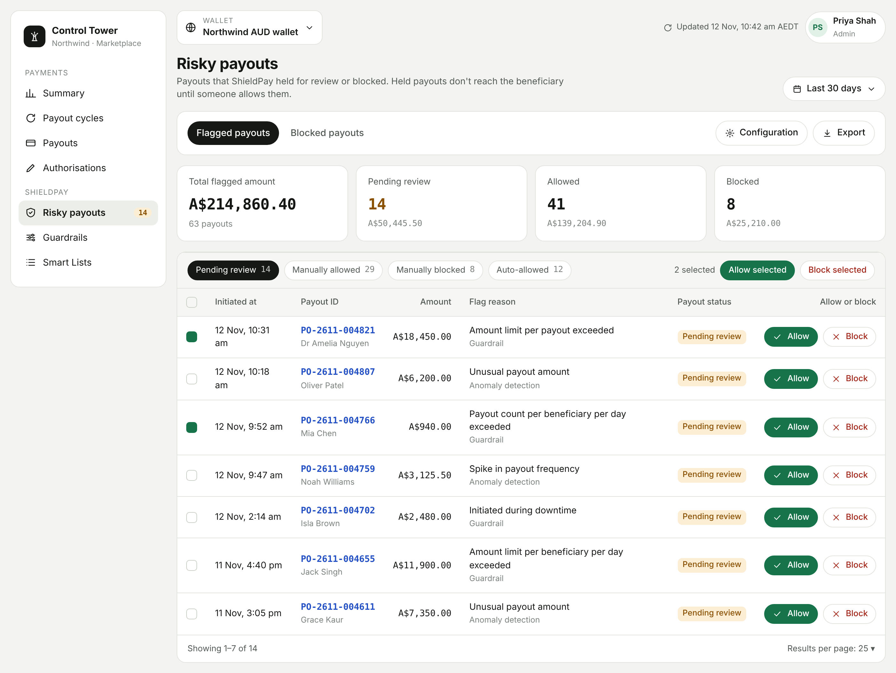

<Info>
  ShieldPay is in development and not yet available. This page describes how it will work.
</Info>

ShieldPay checks each payout before any money moves. It stops payouts that look like fraud, a security breach, or an operational mistake, so you don't lose funds. Risky payouts are either blocked outright or held until someone on your team reviews them in the dashboard.

<Frame caption="Flagged payouts wait in the dashboard until someone allows or blocks them.">
  
</Frame>

## What ShieldPay includes

<Columns cols={3}>
  <Card title="Anomaly detection" icon="chart-line" href="/shieldpay/anomaly-detection">
    A machine learning model that spots payouts that don't match your normal pattern, in real time.
  </Card>
  <Card title="Guardrails" icon="sliders" href="/shieldpay/guardrails">
    Velocity controls that cap the number of payouts and the total amount paid.
  </Card>
  <Card title="Review workflow" icon="user-check" href="/shieldpay/flagged-payouts">
    Flagged payouts are held for a person to investigate, then allow or block.
  </Card>
</Columns>

## Why use ShieldPay

| Risk | How ShieldPay helps |
|---|---|
| Dangerous entities | Blocks payouts to known fraudulent recipients, using the ShieldPay risk list. |
| Money laundering | Blocks unusual payouts to other payment aggregators. |
| Account takeover | Detects unauthorised access, such as someone using your API credentials to make payouts. |
| Excessive payouts | Smart limits on payout volume catch surges caused by bugs or operational errors. |
| Accounts you don't trust | Your own blocklist stops payouts to any account you consider suspicious. |
| Unusual patterns | Watches for unusual amounts, high volumes, unfamiliar destinations, and off-hours spikes. |

## What happens to a payout

Every payout you create, through the API or the dashboard, is scanned. A payout has one of three outcomes.

| Outcome | What it means | Where to see it |
|---|---|---|
| Passed | No risk found. The payout is sent as normal. | Payouts |
| Flagged | Held for review. It doesn't reach the beneficiary unless someone allows it. | [Flagged payouts](/shieldpay/flagged-payouts) |
| Blocked | Stopped permanently. A blocked payout can't be unblocked. | [Blocked payouts](/shieldpay/blocked-payouts) |

Three things can flag or block a payout:

- **Anomaly detection** flags payouts that deviate from your expected behaviour, and blocks payouts to recipients on the ShieldPay risk list.
- **Guardrails** reject or hold payouts that breach an amount limit, a count limit, or your downtime window.
- **Smart Lists** block payouts to anyone on your own blocklist. Payouts to anyone on your trusted list skip risk checks.

## Set up ShieldPay

<Steps>
  <Step title="Turn on anomaly detection">
    Email [hello@mygigsters.com.au](mailto:hello@mygigsters.com.au) to have the model enabled for your account. No integration work is needed. See [Anomaly detection](/shieldpay/anomaly-detection).
  </Step>
  <Step title="Set your Guardrails">
    Apply the recommended guardrails in one click, or set each limit yourself. See [Guardrails](/shieldpay/guardrails).
  </Step>
  <Step title="Add your Smart Lists">
    Add the accounts you want blocked, and the beneficiaries you trust. See [Smart Lists](/shieldpay/smart-lists).
  </Step>
  <Step title="Review risky payouts">
    Check [flagged payouts](/shieldpay/flagged-payouts) and decide whether to allow or block each one.
  </Step>
  <Step title="Handle the new statuses in your integration">
    A held or blocked payout returns a new status through the API. See [Statuses and webhooks](/shieldpay/statuses-and-webhooks).
  </Step>
</Steps>
