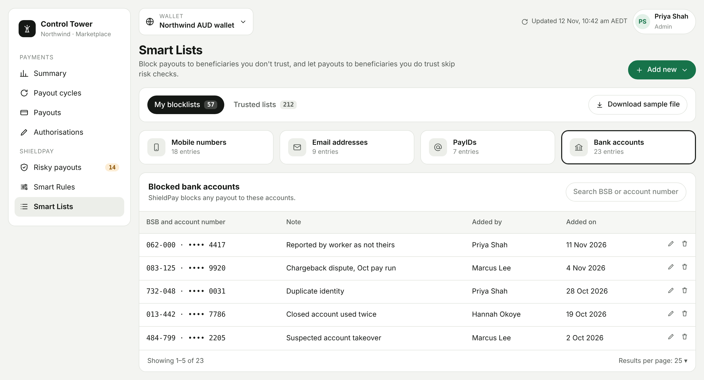

<Info>
  ShieldPay is in development and not yet available. This page describes how it will work.
</Info>

Smart Lists are lists you maintain yourself. There are two kinds.

| List | What it does |
|---|---|
| My blocklists | ShieldPay blocks every payout to a recipient on the list. |
| Trusted lists | Payouts to a recipient on the list proceed without risk checks. |

<Frame caption="Smart Lists in the dashboard.">
  
</Frame>

## What you can list

Both kinds of list accept the same four identifier types.

| Type | What to enter |
|---|---|
| Mobile number | The recipient's mobile number. |
| Email address | The recipient's email address. |
| PayID | The recipient's PayID. |
| Bank account | The account number and its bank code (the BSB in Australia). |

## My blocklists

Go to **ShieldPay > Smart Lists > My blocklists**.

### Add entries

<Steps>
  <Step title="Choose the type">
    Open the **Add new** menu and select the identifier type.
  </Step>
  <Step title="Enter one value or upload many">
    To add one entry, type the value. To add several, download the sample file, fill it in using the same format, and upload it. For a bank account, enter both the account number and the bank code.
  </Step>
  <Step title="Save">
    Select **Add now**.
  </Step>
</Steps>

### View, edit, and delete entries

- **View:** select a type to see its full list. You can also add entries from this screen.
- **Edit:** select the **Edit** icon, change the value or upload an updated file, then select **Add now**.
- **Delete:** select the **Delete** icon next to the entry, then confirm.

### What happens to a blocked payout

A payout to a recipient on your blocklist is blocked before any money moves. It appears under [Blocked payouts](/shieldpay/blocked-payouts) with a block reason that names the list type, for example **Blocklist: bank account**. Through the API, the payout has the status `REJECTED` and the status code `BENE_BLACKLISTED`.

## Trusted lists

Go to **ShieldPay > Smart Lists > Trusted lists**.

Add, view, edit, and delete entries the same way as for blocklists. You can also add a beneficiary to your trusted list while reviewing a flagged payout, by selecting **Allow and trust beneficiary**.

<Warning>
  Payouts to trusted recipients skip risk checks. Only add recipients you have verified.
</Warning>
