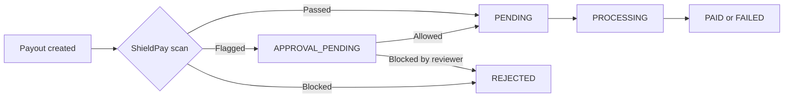

<Info>
  ShieldPay is in development and not yet available. This page describes how it will work.
</Info>

ShieldPay adds two payout statuses and a `status_code` field. Your integration needs to handle them wherever it reads a payout's status: the response when you create a payout, [Payout status](/api-reference/payouts/payout-status), and [Payout history](/api-reference/payouts/payout-history).

## New statuses

| Status | What it means | What to do |
|---|---|---|
| `APPROVAL_PENDING` | ShieldPay is holding the payout for review. No money has moved. | Wait. Someone on your team allows or blocks it in the dashboard. |
| `REJECTED` | ShieldPay blocked the payout, or a reviewer blocked it. This is final. | Don't retry automatically. Check the status code first. |

A held or blocked payout is still returned with HTTP `200`. Check `status` and `status_code` to tell them apart from a payout that's processing normally.

## Status codes

| Status | Status code | What it means |
|---|---|---|
| `APPROVAL_PENDING` | `ANOMALY_DETECTION` | Anomaly detection flagged the payout as high risk. Allow or block it under **Risky payouts > Flagged payouts**. |
| `APPROVAL_PENDING` | `TRANSFER_LIMIT_BREACH` | The payout breached an amount limit and needs approval. |
| `APPROVAL_PENDING` | `VELOCITY_CHECK_FAILED` | The number of payouts to this beneficiary breached a count limit and needs approval. |
| `APPROVAL_PENDING` | `INSIDE_BLACKOUT_WINDOW` | The payout was created during downtime and needs approval. |
| `REJECTED` | `ANOMALY_DETECTION` | ShieldPay detected an anomaly and rejected the payout. Validate it on your side before trying again. |
| `REJECTED` | `BENE_BLACKLISTED` | The recipient's bank account, PayID, email, or mobile number is on the ShieldPay risk list or on your blocklist. |
| `REJECTED` | `TRANSFER_LIMIT_BREACH` | The payout breached an amount limit set to reject. |
| `REJECTED` | `VELOCITY_CHECK_FAILED` | The payout breached a payout count limit set to reject. |
| `REJECTED` | `INSIDE_BLACKOUT_WINDOW` | The payout was created during downtime. Try again after the window, or change the window. |
| `REJECTED` | `MANUALLY_REJECTED` | Someone on your team blocked the payout during review. |

## Example

```json Payout held for review
{
  "status": 200,
  "message": "Payout held for review by ShieldPay.",
  "data": {
    "payout_id": "PO-2611-004807",
    "worker_id": "wkr_7c1e9a40d2",
    "amount": 6200.00,
    "currency": "AUD",
    "status": "APPROVAL_PENDING",
    "status_code": "ANOMALY_DETECTION",
    "status_description": "Held by ShieldPay. Allow or block this payout in the dashboard."
  }
}
```

## How a held payout moves on



## Webhooks

ShieldPay adds three payout events. They use the same envelope and signature as the existing [webhook events](/security/webhooks).

| Event | When it's sent |
|---|---|
| `payout.flagged` | A payout is held for review. Its status is `APPROVAL_PENDING`. |
| `payout.allowed` | A held payout is allowed, by a reviewer or by auto-allow. |
| `payout.blocked` | A payout is blocked, by ShieldPay or by a reviewer. Its status is `REJECTED`. |

`payout.succeeded` and `payout.failed` are still sent when an allowed payout finishes.

## Notifications

ShieldPay also sends a daily summary of flagged and blocked payouts by email and SMS.
