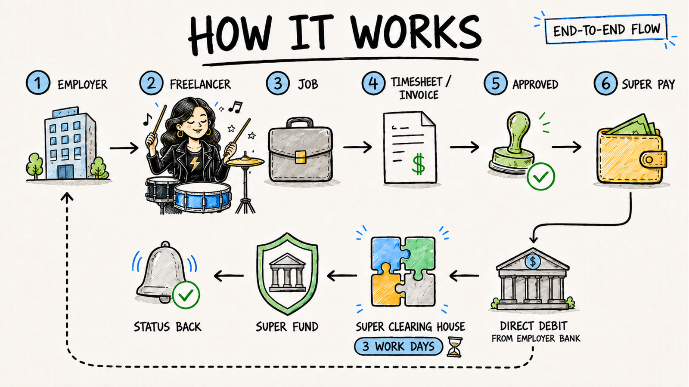

## Build with MyGigsters Super

If freelancers earn through your marketplace, someone has to get their super right: collect fund details, check them, pay the contribution, and confirm it arrived. MyGigsters Super does that for you. You send the contribution, and we debit the employer, clear the payment, deliver it to the fund, and report the status back.

<Columns cols={2}>
  <Card title="Quickstart" icon="rocket" href="/super/quickstart">
    Go from API key to your first contribution.
  </Card>
  <Card title="API reference" icon="code" href="/super/api-reference/funds/get-active-superannuation-funds">
    Every super endpoint, parameter, and response.
  </Card>
</Columns>

## Two ways to build

<Columns cols={2}>
  <Card title="Build with the API" icon="code" href="/super/quickstart">
    Create employers and employees, validate funds, and submit contributions from your own backend, with your own screens.
  </Card>
  <Card title="Use embedded components" icon="window-maximize" href="/super/components/overview">
    Embed MyGigsters' onboarding screens for employers and freelancers in your product. No screens to build.
  </Card>
</Columns>

## Why MyGigsters Super

<Columns cols={3}>
  <Card title="Simple onboarding" icon="link">
    Send a magic link and freelancers enter their own super details. No forms for you to build.
  </Card>
  <Card title="Invoices and payments built in" icon="credit-card">
    Super sits alongside the invoices and payouts you already run through MyGigsters.
  </Card>
  <Card title="SuperStream compliant" icon="shield-halved">
    Contributions go through a superannuation clearing house in the format funds require.
  </Card>
  <Card title="Smart validations" icon="user-check">
    Check tax file numbers and fund details up front, before a payment can fail.
  </Card>
  <Card title="Payslips" icon="file-invoice-dollar">
    Give freelancers a record of what was paid and where it went.
  </Card>
  <Card title="Finance for super" icon="building-columns">
    Coming soon.
  </Card>
</Columns>

## How it works

<Frame caption="From a completed job to super in the freelancer's fund, with the status reported back to the employer.">
  
</Frame>

<Steps>
  <Step title="Work is done and approved">
    A freelancer completes a job for an employer on your marketplace. The timesheet or invoice is approved.
  </Step>
  <Step title="You submit the super contribution">
    Your marketplace sends the contribution through the API.
  </Step>
  <Step title="The employer is debited">
    The contribution is collected from the employer's bank account by direct debit.
  </Step>
  <Step title="The clearing house delivers it">
    The superannuation clearing house passes the contribution to the freelancer's super fund. This takes about 3 working days.
  </Step>
  <Step title="You get the status back">
    Track each contribution through to the fund with the history and payment status endpoints, or with webhooks.
  </Step>
</Steps>

## What you can do with the API

| API | What it does | Why it's useful to you |
|---|---|---|
| [Get active superannuation funds](/super/api-reference/funds/get-active-superannuation-funds) | Returns every super fund that is registered, active, and able to receive electronic contributions. | Populate a searchable drop-down of funds in your own product. |
| [Validate superannuation fund](/super/api-reference/funds/validate-superannuation-fund) | Checks whether a fund's USI is correct and active. | Check the USIs your freelancers have already entered, so you know each fund can receive contributions. |
| [SuperSelector](/super/api-reference/funds/superselector) | Searches for a freelancer's existing super funds using their name, date of birth, and postcode. | Pre-fill a freelancer's super details. It finds a match at least 60% of the time. If nothing is found, the freelancer enters their details manually. |
| [Member verification (MVR)](/super/guides/member-verification) | Asks the fund whether it will accept contributions for a particular member. Funds can take up to 24 hours to respond. | Make sure the member you are onboarding can receive contributions with the details they gave you. |
| [Onboard employer](/super/api-reference/employers/onboard-employer) | Creates the employer of record, with company details, contact, and payment account. | Set up the bank account that contributions are debited from. |
| [Submit contribution](/super/api-reference/contributions/submit-contribution) | Submits super contributions. | Pay super for several freelancers and funds in one request. |
| [Get contribution history](/super/api-reference/contributions/get-contribution-history) | Returns the details of the contributions you have submitted. | Get a status update on every submitted contribution. |

## Go further

<Columns cols={2}>
  <Card title="Verify members before you pay" icon="user-check" href="/super/guides/member-verification">
    Catch a wrong member number or an ineligible fund up front.
  </Card>
  <Card title="Submit large batches" icon="layer-group" href="/super/guides/async-submissions">
    Send up to 100 funds and 1,000 members in one asynchronous request.
  </Card>
  <Card title="Pay self-managed funds" icon="piggy-bank" href="/super/guides/smsf">
    Validate and pay contributions to SMSFs.
  </Card>
  <Card title="Embedded components" icon="window-maximize" href="/super/components/overview">
    Drop pre-built onboarding and management screens into your product.
  </Card>
</Columns>

<Note>
  Questions about your integration? Email [hello@mygigsters.com.au](mailto:hello@mygigsters.com.au).
</Note>
